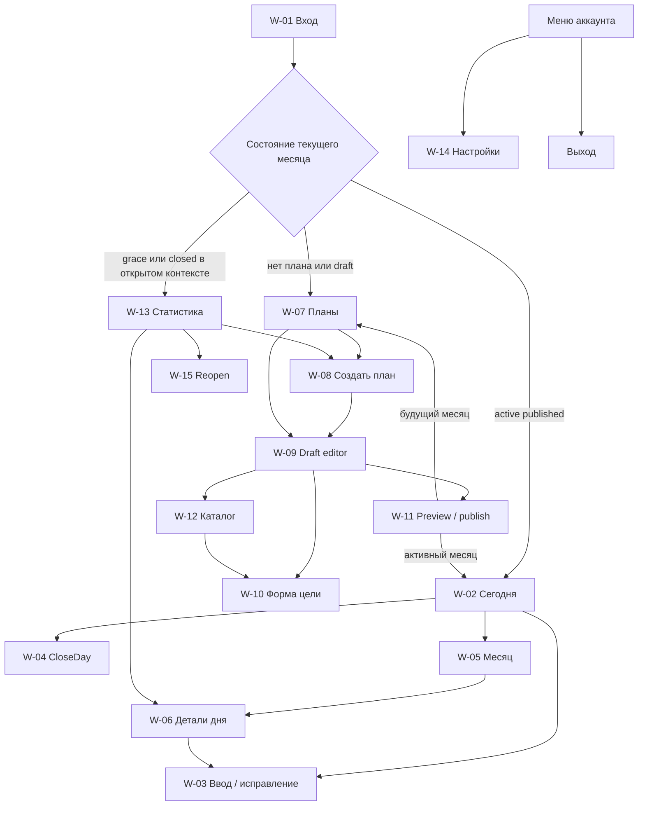

# Карта экранов frontend Planner — полный web-пилот

**Версия:** 1.0
**Дата:** 24 августа 2026 года
**Статус:** продуктовый baseline для прототипирования и frontend-реализации
**Backend baseline:** `planner-backend@44f00d00715d6a485ad5aff3f36680a414af96ae`
**Источники:** backend `PRD.md`, `USER_FLOWS.md`, `SCREEN_MAP.md`, `docs/api/openapi.json`

## 1. Назначение и границы

Документ переводит путь Дениса и Тани в карту адаптивного web-интерфейса. Он фиксирует пользовательские назначения, состояния, переходы и зависимости от backend API, но не выбирает URL-схему, визуальный стиль, сетку, framework, библиотеку компонентов или способ показа вторичных поверхностей.

Карта покрывает все web-jobs `W-01…W-15` исходной продуктовой спецификации. Идентификатор `W-xx` обозначает самостоятельную UX-задачу, а не обязательный отдельный URL или отдельный визуальный контейнер. Несколько jobs можно объединять на одном экране, если сохраняются их состояния, recovery-сценарии и трассировка.

В пилот входят:

- закрытый вход через Telegram OIDC и локальная web-сессия;
- создание, редактирование, preview и публикация месячного плана;
- «Сегодня», календарь месяца, ввод, исправление, удаление, Undo и CloseDay;
- личные reminder settings и состояние доставки в Telegram;
- отчёт, обычный `grace`, автоматическое закрытие, явное повторное открытие и повторное закрытие;
- функциональный паритет mobile и desktop в online-only режиме.

Не входят:

- Telegram-редактор плана и спецификация экранов самого бота;
- realtime-синхронизация между уже открытыми вкладками или каналами;
- offline-очередь, PWA и оптимистическое подтверждение неподтверждённых mutations;
- расширенная аналитика завершённой v1, AI-ввод, public signup и multi-space;
- hosting, детальный implementation plan и техническая структура frontend-кода.

## 2. Информационная архитектура

### 2.1. Глобальная оболочка

После авторизации пользователь всегда видит одну web-оболочку с четырьмя главными назначениями:

1. **Сегодня** — `W-02` и быстрые действия `W-03/W-04`.
2. **Месяц** — `W-05` и детали даты `W-06`.
3. **Планы** — `W-07`, создание `W-08`, draft `W-09`, форма цели `W-10`, preview `W-11` и вложенный каталог `W-12`.
4. **Статистика** — `W-13` и lifecycle-действия закрытого месяца, включая `W-15`.

`W-14 Настройки` и выход находятся в меню аккаунта, а не образуют пятое главное назначение. Идентичность текущего участника и партнёра должна приходить от backend; интерфейс не выводит persona из UUID, порядка участников или локальной константы.

Оболочка также предоставляет:

- видимый выбранный календарный месяц там, где данные зависят от месяца;
- статус `draft/published/grace/closed`, режим `ordinary/reopened` и понятное следующее допустимое действие;
- возврат в исходный контекст после отмены вторичного действия;
- явное состояние потери сессии и безопасный повторный вход;
- уведомление о потере связи без объявления неизвестного результата успешным.

Месячный переключатель не должен создавать иллюзию, что backend уже умеет перечислять доступные месяцы: до закрытия `GAP-02` frontend может открывать только известный из текущего контекста `targetMonth`, но полноценная навигация по истории является блокирующей зависимостью пилота.

### 2.2. Route-level и вторичные surfaces

Классификация описывает информационную самостоятельность, а не конкретный UI-паттерн.

| Surface | Класс | Место в архитектуре |
| --- | --- | --- |
| `W-01` | Route-level, вне авторизованной оболочки | Вход и callback recovery |
| `W-02` | Route-level, главное назначение | Сегодня |
| `W-03` | Вторичная/contextual | Ввод, исправление, удаление или Undo из дня |
| `W-04` | Вторичная/contextual | Подтверждение CloseDay из дня |
| `W-05` | Route-level, главное назначение | Месяц |
| `W-06` | Route-level, вложенный контекст | Детали выбранного дня |
| `W-07` | Route-level, главное назначение | Планы |
| `W-08` | Вторичная flow-surface | Выбор источника нового draft внутри Планов |
| `W-09` | Route-level, вложенный контекст | Редактор draft |
| `W-10` | Вторичная/contextual | Создание или изменение цели из draft/каталога |
| `W-11` | Route-level, вложенный контекст | Revision-bound preview и публикация |
| `W-12` | Route-level, вложенный раздел | Каталог внутри Планов |
| `W-13` | Route-level, главное назначение | Статистика |
| `W-14` | Route-level, служебный раздел | Настройки из меню аккаунта |
| `W-15` | Вторичная/contextual | Подтверждение reopen из закрытого отчёта |

Для route-level surface требуется восстанавливаемое состояние после reload и понятный выход в ближайшее главное назначение. Вторичная surface сохраняет исходный контекст, имеет явные действия «подтвердить/сохранить» и «отменить» и не определяет заранее, будет ли показана отдельной страницей, диалогом, панелью или иным паттерном.

### 2.3. Карта переходов

## 3. Backend-зависимости и именованные gaps

В разделах ниже используются OpenAPI `operationId` из зафиксированного backend baseline. `EXISTING` означает, что операция присутствует в live OpenAPI; это не доказывает опубликованный deployment. `GAP` означает, что surface нельзя считать полностью реализуемой без дополнения backend-контракта.

| ID | Обязательная backend-зависимость |
| --- | --- |
| `GAP-01` | Профиль закрытого пространства: текущий member, участники пары, display names и утверждённое соответствие persona без frontend-хардкода |
| `GAP-02` | Список доступных месяцев/планов с lifecycle, draft/publication identifiers и revision для навигации «Планы», «Месяц» и «Статистика» |
| `GAP-03` | Создание пустого draft |
| `GAP-04` | Создание draft из выбранной прошлой publication с preview переносимой конфигурации и явным исключением фактов |
| `GAP-05` | Изменение обязательного focus существующего draft с revision guard |
| `GAP-06` | Cancel будущей publication обратно в draft и последующая republish с однозначным lifecycle/revision-контрактом |
| `GAP-07` | Bounded read model аудита фактов и lifecycle: исходные действия, revisions, причины, авторы/system actor, старые и новые значения/statuses |
| `GAP-08` | Утверждённый browser redirect/result для отмены и ошибок Telegram OIDC callback, пригодный для показа в `W-01` |
| `GAP-09` | Bot navigation metadata: безопасная ссылка/идентификатор личного чата и доступные переходы из web |

Все unsafe-операции дополнительно зависят от `AuthController_csrfToken`, session cookie и серверной проверки browser origin. Все ошибки читаются как `application/problem+json`; неизвестный `code` остаётся общей service error, а не трактуется как success. `revision`, `factsRevision`, bigint-подобные значения и точные ratio/decimal strings остаются строками и не приводятся к JavaScript `number` в продуктовой модели.

## 4. Web-поверхности

### W-01. Вход через Telegram

**Класс:** route-level, публичная surface вне app shell.
**Назначение:** безопасно получить локальную web-сессию одного из двух разрешённых участников через Telegram OIDC.

**Ключевая информация и действия:** основное действие «Продолжить через Telegram»; короткое объяснение redirect/callback; отсутствие зависимости от username и номера телефона; безопасный повтор после ошибки; переход в личный чат бота только при наличии server-provided metadata.

**Состояния:** сессия уже активна; вход не начат; redirect выполняется; callback обрабатывается; пользователь отменил вход; provider временно недоступен; callback/state/nonce/PKCE отклонён; Telegram ID не в allowlist; сессия создана; сессия истекла во время работы.

**Переходы:** успешный вход → состояние, полученное из `TrackingQueryController_today`: `published/active` → `W-02`, `published/grace|closed` → `W-13`, `published/future`, `draft` или `no_plan` → `W-07`; восстановление защищённого deep link допускается только после проверки доступа и актуальности контекста. Ошибка → тот же `W-01` с новым запуском входа. Logout из app shell → `W-01`.

**Адаптация:** на mobile и desktop доступны одинаковые объяснение, статус операции, retry и отказ доступа; callback loading не требует удерживать исходное окно определённого размера.

**Flows:** `UF-01`; входная точка для `UF-02…UF-08` после потери сессии.

**API:** `EXISTING` — `startTelegramOidcLogin`, `completeTelegramOidcLogin`, `AuthController_me`, `AuthController_csrfToken`, `AuthController_logout`, `TrackingQueryController_today`. `GAP-01`, `GAP-08`, `GAP-09`.

### W-02. Сегодня

**Класс:** route-level, главное назначение «Сегодня».
**Назначение:** показать применимые действия и подтверждённый прогресс текущего дня с минимальным числом переходов до ввода.

**Ключевая информация и действия:** локальная дата `Asia/Yekaterinburg`; focus; фаза и lifecycle месяца; собственные, shared и partner read-only цели; фиксированные ожидания; гибкий факт/target/остаток; weekly planned tasks текущей недели; ввод или исправление; CloseDay; переходы к месяцу и статистике. Авторство выводится через profile mapping, а не через сырой UUID.

**Состояния:** `no_plan`; `draft`; future published до активации; active published с пустым, частичным или заполненным днём; день закрыт; нет применимых ожиданий; обычный `grace`; reopened `grace`; `closed`; late publication с `not_applicable`; partner read-only; loading, service error, stale refetch.

**Переходы:** применимая цель/запись → `W-03`; CloseDay → `W-04`; дата/календарь → `W-05/W-06`; статистика → `W-13`; `no_plan/draft` → `W-07`; future/closed остаются read-only с объяснением допустимого следующего действия.

**Адаптация:** mobile приоритизирует текущие незавершённые действия и крупную touch-target зону быстрого ввода; desktop может показывать больше контекста одновременно. Порядок целей, доступность действий, подписи статусов и результат расчётов совпадают.

**Flows:** `UF-04`, `UF-05`, `UF-07`; `UF-06` использует Today как вход в календарь и детали дня.

**API:** `EXISTING` — `TrackingQueryController_today`, `PlanningMonthController_active`; mutations делегированы API `W-03/W-04`. `GAP-01` для имён и persona.

### W-03. Ввод, исправление и обслуживание записи

**Класс:** secondary/contextual surface из `W-02` или `W-06`.
**Назначение:** применить ровно одно типизированное действие и показать только подтверждённое backend-состояние.

**Ключевая информация и действия:** цель, дата/период, владелец и access mode; текущий факт и revision; типизированный control; единица и правило `add/latest`; checkpoint или компонент; обязательная причина correction/personal delete; подтверждение, отмена, допустимые delete и Undo.

| Тип | Ожидаемый ввод и подтверждение |
| --- | --- |
| Boolean | `done` либо явное `not_done`; новый статус и автор |
| Quantity `add` | Порция и единица; добавленная порция, сумма и остаток |
| Quantity `latest` | Последнее значение; заменившее значение и прогресс |
| Actual time | Дата ожидания и локальное время; попадание в диапазон |
| Rating | Значение конкретного checkpoint; сохранённая оценка без ложного pass/fail |
| Text | Непустой текст и `done/not_done`; текст, результат и coverage |
| Checklist | Конкретный подпункт/occurrence; частичный прогресс и coverage |
| Варианты «или» | Выбранный вариант и его значение; прогресс по максимуму одного варианта |
| Informational quantity | Значение без target; факт без score и остатка |
| Weekly planned task | `done/not_done` для календарной недели; результат, период и автор |

**Состояния:** новый ввод; частичный прогресс; сохранено; validation error у конкретного значения; pending; exact duplicate; stale revision; target unavailable; конфликт существующего факта; read-only; `not_applicable`; future; closed; delete/Undo недоступны; неизвестный результат после потери связи.

**Права:** собственную personal-запись изменяет только владелец; personal-запись партнёра read-only; shared ввод доступен обоим; любая correction и personal delete требуют непустую причину, а для shared correction backend дополнительно проверяет права; shared delete запрещён; Undo относится к последнему допустимому собственному действию и не перескакивает через последующую несовместимую revision.

**Переходы:** подтверждённый результат → refetch исходного `W-02/W-06`; отмена → исходный контекст без mutation; stale/conflict → показать актуальное состояние и предложить заново принять решение; неизвестный outcome → повторить тот же request с тем же `commandId`, не генерируя второй intent.

**Адаптация:** mobile поддерживает ввод одной рукой, правильную клавиатуру для типа значения и сохранение контекста при системном выборе времени; desktop не добавляет действий, отсутствующих на mobile. Длинные тексты, причины и единицы доступны без горизонтальной прокрутки.

**Flows:** `UF-05`; разрешённое исправление из `UF-06`; weekly result и correction из `UF-07`; исправления grace из `UF-08`. Действия из Telegram после refetch отражаются тем же authoritative read model, но отдельным frontend flow не являются.

**API:** `EXISTING` — `ScalarFactController_recordFact`, `ScalarFactController_recordTime`, `ScalarFactController_recordRating`, `ScalarFactController_recordCheckpoint`, `CompositeFactController_recordText`, `CompositeFactController_recordChecklistItem`, `CompositeFactController_recordOrVariant`, `CompositeFactController_recordCompositeOccurrence`, `FactMaintenanceController_recordWeeklyTaskResult`, `FactMaintenanceController_correct`, `FactMaintenanceController_delete`, `FactMaintenanceController_undo`, а также read models `TrackingQueryController_today`, `TrackingQueryController_month`. `GAP-01`, `GAP-07`.

### W-04. Подтверждение закрытия дня

**Класс:** secondary/contextual confirmation из `W-02` или `W-06`.
**Назначение:** до atomic CloseDay показать точный серверный набор незаполненных фиксированных ожиданий, которые станут `not_done`.

**Ключевая информация и действия:** выбранная дата; граница correction window; personal/shared ожидания из server preview; явное исключение гибких квот и `weekly_planned_task`; Confirm/Cancel; результат с числом закрытых ожиданий.

**Состояния:** preview loading; есть пункты; нечего закрывать; день уже закрыт; future/pre-activation; дата вне correction window; preview устарел; exact duplicate; target conflict; service error с безопасным reload.

**Переходы:** подтвердить → backend CloseDay → refetch `W-02/W-06`; отменить → исходный день; preview/target conflict → новый preview без скрытого применения старого набора.

**Адаптация:** полный список последствий и исключений одинаков на mobile и desktop; подтверждение не заслоняет выбранную дату и не полагается только на цвет предупреждения.

**Flows:** `UF-07`.

**API:** `EXISTING` — `FactMaintenanceController_closeDayPreview`, `FactMaintenanceController_closeDay`, затем `TrackingQueryController_today`, `TrackingQueryController_month`. Дополнительного GAP нет.

### W-05. Месяц

**Класс:** route-level, главное назначение «Месяц».
**Назначение:** показать календарное состояние всех дат выбранного месяца и дать доступ к деталям дня.

**Ключевая информация и действия:** месяц и focus; status/mode/phase; легенда `done/not_done/no_data/not_applicable`; coverage и календарные состояния `future/not_applicable/no_data/partial/filled`; late activation; выбор даты; переход к плану или отчёту.

**Состояния месяца:** нет плана; draft; future published; active published; ordinary grace; closed; reopened grace; revised report после reclose. **Состояния даты:** future; pre-activation `not_applicable`; open без данных; partial; filled; явно закрытая; read-only из-за lifecycle.

**Переходы:** дата → `W-06`; plan status → `W-07`; report → `W-13`; выбор другого доступного месяца → перезагрузка server read model для этого `targetMonth`.

**Адаптация:** mobile и desktop показывают все календарные даты, легенду и те же значения; допускается разная плотность и форма обзора, но не скрытие статусов или истории. Выбранная дата имеет нецветовой индикатор и доступное имя.

**Flows:** `UF-02`, `UF-04`, `UF-05`, `UF-06`, `UF-08`.

**API:** `EXISTING` — `TrackingQueryController_month`; при известном publication — `PlanningPublicationController_get`. `GAP-02` для перечня и переключения доступных месяцев, `GAP-01` для имён участников.

### W-06. Детали дня

**Класс:** route-level, вложенный контекст «Месяца» и «Статистики».
**Назначение:** объяснить состояние выбранной даты на уровне ожиданий и фактов и дать допустимые исправления.

**Ключевая информация и действия:** дата; closure; coverage; цели и ожидания; текущие факты, authors и revisions; personal/shared access; причины `not_applicable/no_data`; переход к `W-03`; CloseDay через `W-04`; возврат к календарю или отчёту.

**Состояния:** future; pre-activation `not_applicable`; active editable; ordinary grace editable в разрешённых границах; reopened grace editable; closed read-only; empty/no_data; partial; filled; service error; запись стала stale между чтением и действием.

**Переходы:** запись → `W-03`; закрыть день → `W-04`; назад → исходный `W-05` или `W-13` с сохранённым месяцем/датой; closed mutation request → объяснение и при наличии права переход к lifecycle action `W-15` через `W-13`.

**Адаптация:** mobile может раскрывать цели последовательно, desktop — параллельно с месячным контекстом; в обоих случаях доступны все значения, authors, причины блокировки и действия.

**Flows:** `UF-05`, `UF-06`, `UF-08`.

**API:** `EXISTING` — `TrackingQueryController_month` и mutation operations `W-03/W-04`. `GAP-01`, `GAP-07` для полной истории исправлений.

### W-07. Планы и состояния месяцев

**Класс:** route-level, главное назначение «Планы».
**Назначение:** быть единой точкой входа в создание, продолжение draft, просмотр immutable publication и подготовку следующего месяца.

**Ключевая информация и действия:** известные текущий, следующий и прошлые месяцы; lifecycle и mode; draft/publication revision; продолжить draft; открыть опубликованную конфигурацию; создать следующий план; cancel future publication, когда это разрешено; перейти к отчёту закрытого месяца.

**Состояния:** список пуст; нет плана для целевого месяца; draft; future published; active published; ordinary grace; closed; reopened grace; revised after reclose; loading; service error; конфликт после параллельного изменения.

**Переходы:** создать → `W-08`; draft → `W-09`; immutable publication → просмотр через `W-11` без publish action либо `W-02/W-05`; отчет → `W-13`; cancel future publication → возвращённый backend draft → `W-09`.

**Адаптация:** mobile и desktop показывают одинаковые месяцы, статусы и действия; mobile не сводится только к текущему месяцу. Длинная история может раскрываться постепенно, но выбранный месяц и доступность следующего действия не теряются.

**Flows:** `UF-02`, `UF-04`, `UF-08`.

**API:** `EXISTING` частично — `PlanningMonthController_active`, `PlanningDraftController_editor` для заранее известного `targetMonth`, `PlanningPublicationController_get` для известного `publicationId`, `TrackingQueryController_month`. Блокирующие `GAP-02`, `GAP-06`.

### W-08. Создание плана

**Класс:** secondary flow-surface внутри `W-07`.
**Назначение:** выбрать календарный месяц и один допустимый источник нового draft без переноса фактов.

**Ключевая информация и действия:** target month; одноразовый seed при доступности; выбор persona текущего участника только для seed; пустой draft; копирование выбранной прошлой publication; preview того, что переносится и не переносится; обязательный focus; Confirm/Cancel.

**Состояния:** первый seed ещё доступен; seed уже consumed; доступен прошлый published month; нет источника копирования; draft уже существует; publication уже существует; target month недопустим; exact duplicate command; conflict с другим созданием; service error с неизвестным результатом.

**Переходы:** подтверждённый draft → `W-09`; existing draft conflict → открыть существующий `W-09`; already published → открыть `W-07/W-11`; cancel → `W-07`; неизвестный outcome → повтор с тем же `commandId`.

**Адаптация:** все три источника, их ограничения и preview доступны на обоих устройствах; mobile допускает последовательный выбор, desktop — одновременное сравнение, но итоговый payload и подтверждение одинаковы.

**Flows:** `UF-02`; следующий план из `UF-08`.

**API:** `EXISTING` только для seed — `PlanningDraftController_createFromSeed`. Блокирующие `GAP-01` для надёжного persona mapping, `GAP-02` для выбора источника, `GAP-03`, `GAP-04`, `GAP-05`.

### W-09. Редактор черновика

**Класс:** route-level, вложенный раздел «Планы».
**Назначение:** собрать и упорядочить однозначную конфигурацию месяца до публикации.

**Ключевая информация и действия:** target month и focus; `planMonthRevision/draftRevision`; цели с owner/access, типом, repetition, measurement и порядком; blockers; добавить из каталога; создать/скопировать цель; изменить цель; detach только из текущего draft; reorder; перейти к preview.

**Состояния:** пустой draft; draft с blockers; готовый draft; mutation pending; подтверждённая revision; validation error; stale plan/draft revision; несохранённый локальный ввод; service error; plan опубликован параллельно и редактор стал read-only.

**Переходы:** цель → `W-10`; каталог → `W-12`; preview → `W-11`; назад → `W-07`; stale/conflict → заменить локальное основание актуальным editor read model и попросить пользователя повторно применить конкретную правку, не делать silent overwrite.

**Адаптация:** mobile поддерживает полный edit flow, включая reorder доступным не только drag-жестом способом; desktop может показывать список и форму рядом. Blockers и состояние сохранения видимы на обоих устройствах.

**Flows:** `UF-02`, `UF-03`, `UF-04`.

**API:** `EXISTING` — `PlanningDraftController_editor`, `PlanningDraftController_add`, `PlanningDraftController_update`, `PlanningDraftController_remove`, `PlanningDraftController_reorder`; каталог — operations `W-12`; preview — `PlanningDraftController_publicationPreview`. Блокирующий `GAP-05`; `GAP-01` для display names.

### W-10. Форма цели

**Класс:** secondary/contextual surface из `W-09` или `W-12`.
**Назначение:** создать или изменить каталожное определение и/или типизированную конфигурацию цели текущего draft, не смешивая metadata line и plan snapshot.

**Ключевая информация и действия:** title, why, category; owner `personal/shared`; тип и measurement; repetition; display order в draft; условные поля target/unit/precision/`add|latest`; `targeted|informational`; диапазон actual time; rating scale; checkpoints и `independent|all`; checklist; OR variants; exact `N`, weekdays или target date; Save/Cancel.

**Состояния:** новая catalog definition; копия; новая draft goal; изменение существующей goal revision; валидно; обязательное поле отсутствует; personal owner не выбран; exact `N` не целое или `<1`; targeted quantity без target; пустой checklist/OR/checkpoint; metadata change сохраняет series; copy создаёт новую series; stale revision; source archived; draft уже опубликован.

**Переходы:** сохранение catalog metadata → `W-12` либо продолжение attach в `W-09`; сохранение draft config → `W-09`; cancel → исходный контекст; validation error → та же форма с привязкой к полю; stale → актуальные данные без silent merge.

**Адаптация:** условные секции и помощь по типу цели доступны полностью на mobile; keyboard navigation и последовательность focus не зависят от двухколоночной desktop-компоновки. Reorder вложенных пунктов имеет кнопочный эквивалент жесту.

**Flows:** `UF-03`.

**API:** `EXISTING` — catalog `PlanningController_create`, `PlanningController_get`, `PlanningController_version`, `PlanningController_copy`, `PlanningController_list`; draft `PlanningDraftController_add`, `PlanningDraftController_update`. `GAP-01` для owner labels.

### W-11. Preview и публикация

**Класс:** route-level, вложенный раздел «Планы».
**Назначение:** показать server-calculated итог и атомарно опубликовать только подтверждённый revision-bound preview.

**Ключевая информация и действия:** месяц и focus; цели, owners, нормы, repetition; calculated targets неполных периодов; provenance/resolution; blockers с переходом к источнику; activation mode и late publication consequence; `planMonthRevision`, `draftRevision`, preview schema, formula versions и snapshot hash marker; Publish/Back.

**Состояния:** preview loading; blockers present при успешном read; ready; scheduled next month; immediate current month; late current month; past/far-future blocked; stale revision/schema/hash/hash-version; confirmation pending; published immutable snapshot; exact duplicate replay; already published другой командой; service error/unknown outcome.

**Переходы:** blocker → `W-09/W-10`; back → `W-09`; publish active month → `W-02`; publish future month → `W-07`; already published → существующая immutable publication; stale → получить новый preview и потребовать нового явного подтверждения; unknown outcome → повторить publish с тем же `commandId` и теми же confirmation markers.

**Адаптация:** mobile показывает весь итог и blockers до подтверждения, не скрывая calculated targets в hover; desktop может одновременно показывать оглавление и детали. Публикация не зависит от точности drag/hover и имеет ясный pending state.

**Flows:** `UF-03`, `UF-04`.

**API:** `EXISTING` — `PlanningDraftController_publicationPreview`, `PlanningDraftController_publish`, `PlanningPublicationController_get`. `GAP-06` для cancel/republish future publication; `GAP-01` для owner labels.

### W-12. Каталог целей

**Класс:** route-level, вложенный раздел «Планы», не главное назначение.
**Назначение:** управлять reusable definitions для будущих draft без удаления исторических snapshots.

**Ключевая информация и действия:** active/archived definitions; metadata и versions; создать; скопировать; добавить новую version; archive/restore; добавить выбранную definition в открытый draft; объяснение, что history не меняется.

**Состояния:** active; archived; loading; empty; используется в текущем draft; существует в прошлых publication, но archived сейчас; revision conflict; definition changed/archived параллельно; service error.

**Переходы:** создать/версионировать/копировать → `W-10`; attach → `W-09`; archive/restore → обновлённый `W-12`; назад → `W-09` при входе из draft либо `W-07`.

**Адаптация:** фильтр active/archived, полный смысл definition и все действия доступны на обоих устройствах; destructive-looking archive сопровождается текстом о сохранении истории и не выражается только иконкой.

**Flows:** `UF-03`.

**API:** `EXISTING` — `PlanningController_list`, `PlanningController_get`, `PlanningController_create`, `PlanningController_version`, `PlanningController_copy`, `PlanningController_archive`, `PlanningController_restore`; attach — `PlanningDraftController_add`. GAP для основной catalog-функции отсутствует; `GAP-01` нужен при выборе personal owner в последующей форме.

### W-13. Статистика месяца

**Класс:** route-level, главное назначение «Статистика».
**Назначение:** показать воспроизводимый пилотный отчёт и допустимые lifecycle-действия завершённого месяца.

**Ключевая информация и действия:** выбранный месяц; report status `current/preliminary/closed/revised`; source revisions и `asOfLocalDate`; разделы двух personal owners и shared; `monthScore`, coverage, fact/target; `goalScore`, `progressPercent`; heatmap; quantity cumulative series; actual-time и rating trends; открыть день; создать следующий план; reopen closed; reclose reopened.

**Состояния:** loading; current active month; ordinary preliminary grace; reopened preliminary grace; closed; revised after explicit reclose; нет оцениваемых goals (`N/A`); informational-only goal; недоступная отдельная метрика; нет series points; перевыполнение; stale lifecycle revision; service error.

**Переходы:** heatmap/date → `W-06`; next plan → `W-08`; closed reopen → `W-15`; reopened reclose → явное подтверждение внутри lifecycle-контекста `W-13`, затем revised report; month switch → новый report read.

**Адаптация:** mobile не получает урезанный набор метрик: таблицы/графики могут раскрываться последовательно, но точные значения доступны текстом. Desktop может сопоставлять разделы рядом. График не является единственным носителем значения или статуса.

**Flows:** `UF-08`; текущий прогресс из `UF-05/UF-06`.

**API:** `EXISTING` — `ReportingController_month`, для детализации `TrackingQueryController_month`, lifecycle `PlanningMonthController_reopen`, `PlanningMonthController_reclose`. Блокирующие `GAP-01` для сопоставления `ownerMemberId` с именами и `GAP-02` для выбора месяца; `GAP-07` для полного audit drill-down.

### W-14. Настройки

**Класс:** route-level, служебный раздел из меню аккаунта.
**Назначение:** управлять личными reminder slots и видеть состояние Telegram-доставки и web-сессии.

**Ключевая информация и действия:** display name текущего участника; неизменяемая timezone `Asia/Yekaterinburg`; независимые morning/day/evening times или отключение каждого slot; revision; delivery status `available/blocked/connection_lost`; безопасный переход в личный chat; повторный login; logout. Настройки партнёра не редактируются.

**Состояния:** настройки ещё не созданы; сохранено; mutation pending; validation error времени; stale revision; Telegram available/blocked/connection lost; session expired; service error; partner settings отсутствуют из editable-контекста.

**Переходы:** Save → server-confirmed settings и новый read; stale → refetch и повторное решение; bot link → внешний переход только по metadata; re-login/logout → `W-01`; back → последнее главное назначение.

**Адаптация:** три slots, отключение, timezone, delivery status и recovery доступны одинаково; time input не зависит от desktop-only picker и имеет текстовую доступную подпись.

**Flows:** `UF-01`, `UF-07`.

**API:** `EXISTING` — `ReminderSettingsController_settings`, `ReminderSettingsController_saveSettings`, `ReminderSettingsController_deliveryStatus`, `AuthController_me`, `AuthController_csrfToken`, `AuthController_logout`. `GAP-01`, `GAP-09`.

### W-15. Подтверждение повторного открытия

**Класс:** secondary/contextual confirmation из closed `W-13`.
**Назначение:** разрешить audited corrections закрытого месяца только после явной причины, не разблокируя plan configuration и notifications.

**Ключевая информация и действия:** месяц и closed report revision; обязательная причина; последствия для lifecycle/report; предупреждение, что configuration остаётся immutable и old reminders не возобновляются; Confirm/Cancel.

**Состояния:** причина пустая; готово; mutation pending; reopened grace; stale lifecycle/report revision; месяц уже reopened/reclosed другой командой; exact duplicate; service error/unknown outcome.

**Переходы:** подтвердить → `W-13` в `preliminary + reopened`; cancel → closed `W-13`; stale → актуальный report/lifecycle и новое осознанное решение; после corrections явный reclose в `W-13` → revised report.

**Адаптация:** причина, последствия и подтверждение полностью доступны на обоих устройствах; предупреждение не кодируется только цветом, причина имеет доступное описание обязательности.

**Flows:** `UF-08`.

**API:** `EXISTING` — `PlanningMonthController_reopen`, затем `ReportingController_month`; последующее закрытие — `PlanningMonthController_reclose`. `GAP-07` нужен, чтобы показать пользователю полную историю причин/revisions, но сама reopen/reclose mutation существует.

## 5. Общие продуктовые состояния

### S-01. Lifecycle месяца и отчёта

| Состояние | Что разрешено в web | Основное назначение |
| --- | --- | --- |
| Нет плана | Создать draft | `W-07/W-08` |
| `draft` | Менять focus/config/order/catalog links; tracking недоступен | `W-09…W-12` |
| Future `published` | Immutable preview; ожидание activation; cancel только после `GAP-06` | `W-07/W-11` |
| Active `published` | Ввод, corrections по правам, CloseDay; report `current` | `W-02/W-05/W-13` |
| Ordinary `grace` | Разрешённые corrections; report `preliminary`; config locked | `W-05/W-06/W-13` |
| `closed` | Tracking read-only; report `closed`; возможно explicit reopen | `W-13/W-15` |
| Reopened `grace` | Corrections; report `preliminary`; config и reminders не разблокированы | `W-06/W-13` |
| Reclosed | Tracking read-only; новая immutable revision отчёта `revised` | `W-13` |

Frontend не запускает обычное закрытие месяца вручную: оно выполняется backend lifecycle. Явным web-действием является только reopen закрытого месяца и reclose месяца в режиме `reopened`.

### S-02. Доступ к значениям

| Access | Просмотр | Запись и обслуживание |
| --- | --- | --- |
| `personal_owner` | Оба участника видят подтверждённое состояние | Только владелец вводит; correction и delete требуют причины |
| `partner_read_only` | Текущий пользователь видит цель партнёра | Mutation недоступна с видимой причиной |
| `shared` | Оба видят единый progress | Оба вводят; correction требует причины; shared delete запрещён |
| System actor | Оба видят системный `not_done` и автора системы | Пользователь меняет только через разрешённую correction-команду с причиной |

### S-03. Состояние значения

| Состояние | Смысл интерфейса |
| --- | --- |
| `done` | Явно выполнено; фиксированное ожидание больше не напоминается |
| `not_done` | Явно не выполнено пользователем, CloseDay или CloseWeek |
| `no_data` | Применимое ожидание осталось без записи; не подменять `not_done` |
| `not_applicable` | Ожидание системно исключено, например до late activation |
| Partial flexible | Показывать точный факт, target/expected и остаток |
| Completed flexible | Норма периода достигнута; score и suppression следуют backend |
| Informational | Факт и series без target, score и ложного «успех/провал» |
| `N/A` report metric | Метрика не рассчитывается; не показывать как `0` |

### S-04. Состояние операции

- **Idle/current:** показано последнее подтверждённое read model состояние.
- **Pending:** повторное действие заблокировано, пока нет ответа или неизвестного outcome.
- **Confirmed:** success показывается только после server response и обязательного refetch, когда mutation response не содержит полного read model.
- **Exact duplicate:** тот же `commandId` и fingerprint возвращают прежний результат без второго вклада; UI считает это подтверждением исходной операции.
- **Unknown outcome:** после network loss frontend сохраняет intent в памяти текущего online-сеанса и повторяет только с тем же `commandId`; новая команда не создаётся автоматически.
- **Stale:** server state/revision обновляется, пользователь заново принимает решение; silent overwrite запрещён.
- **Conflict:** подтверждённые данные другого действия не заменяются; UI показывает актуальное состояние и доступный recovery.
- **Blocked:** причина связана с access, lifecycle, future/not-applicable или validation и должна быть видима.

Открытая другая вкладка или Telegram получают новое состояние при следующем fetch/reopen. Карта не обещает push/realtime.

### S-05. Состояние интерфейса

- **Loading:** сохраняется структура и контекст; unsafe action недоступен до получения preconditions.
- **Empty:** объясняется, каких данных нет, и предлагается только реально поддержанное следующее действие.
- **Validation error:** связан с конкретным полем/компонентом и сохраняет уже подтверждённые данные.
- **Service error:** включает понятный retry; неизвестный mutation result не называется неуспехом или успехом до reconciliation.
- **Read-only:** явно названа причина — права, future date, immutable publication, ordinary/reopened lifecycle или closed month.
- **Success:** содержит подтверждённое значение/статус, а не только временное уведомление.
- **Session expired:** защищённые данные скрываются, unsafe intent не повторяется до новой сессии, пользователь возвращается к `W-01`.

## 6. Responsive parity и accessibility

### 6.1. Функциональный паритет

- Все `W-01…W-15`, включая создание плана, полную форму цели, publish, corrections, settings, reopen и reclose, доступны на mobile и desktop.
- Различаться могут плотность, порядок раскрытия и количество одновременно видимых областей, но не данные, права, validation, lifecycle-действия или recovery.
- Daily loop оптимизирован для touch и небольшого viewport; сложное планирование удобнее на desktop, но mobile не превращается в read-only или урезанную версию.
- На обоих устройствах сохраняются выбранный месяц, дата и исходная surface после cancel/back и после успешного refetch.

### 6.2. Accessibility expectations

- Вся навигация, ввод, reorder, archive, publish, CloseDay, reopen и reclose доступны с клавиатуры; drag-and-drop и swipe всегда имеют кнопочный эквивалент.
- Интерактивные цели имеют доступное имя, видимый focus и достаточную touch-target область; порядок focus следует смысловому порядку.
- `done/not_done/no_data/not_applicable`, personal/shared/read-only и lifecycle различаются текстом/иконографикой, а не только цветом.
- Validation связывается с конкретным полем; summary blockers ведёт к источнику ошибки; service error объявляется без потери контекста.
- Графики имеют текстовое представление точных значений, дат и статуса `N/A`; hover не является единственным способом получить данные.
- Pending/status updates и OIDC callback понятны пользователям screen reader; focus после завершения операции перемещается к результату или ошибке предсказуемо.
- Время, дата и timezone подписаны явно; локальная дата не выводится только из timezone браузера.

## 7. Трассировка экранов к user flows

| User flow | Web surfaces | Проверяемый web-результат |
| --- | --- | --- |
| `UF-01` | `W-01`, `W-14` | Разрешённый участник получает локальную session; отказ/ошибка не раскрывают workspace; logout и re-login восстанавливаются |
| `UF-02` | `W-07`, `W-08`, `W-09` | Создан ровно один draft из seed/empty/copy; факты прошлого месяца не перенесены |
| `UF-03` | `W-09`, `W-10`, `W-11`, `W-12` | Все goal types конфигурируются; blockers видимы; stale edit не перезаписывает server state |
| `UF-04` | `W-07`, `W-09`, `W-11`, `W-02` | Revision-bound preview опубликован один раз; activation/late consequences видимы |
| `UF-05` | `W-02`, `W-03`, `W-05`, `W-06` | Все типы web-ввода, rights, correction/delete/Undo и day read model доступны |
| `UF-06` | `W-03`, `W-05`, `W-06`, `W-07`, `W-13` | Календарь и детали дня показывают одну server-owned проекцию; разрешённое исправление и переход к отчёту завершаются согласованным refetch |
| `UF-07` | `W-02`, `W-03`, `W-04`, `W-14` | Личные slots сохраняются независимо; CloseDay закрывает только previewed fixed expectations; weekly task остаётся week-level |
| `UF-08` | `W-05`, `W-06`, `W-07`, `W-08`, `W-13`, `W-15` | Grace/closed/reopened/revised различаются; corrections и следующий draft не меняют прошлый snapshot |

## 8. Набор frames для прототипа и приёмки

Каждый основной сценарий ниже проверяется минимум на mobile и desktop viewport. Визуальный вариант может объединять несколько jobs, но acceptance state каждого идентификатора должен оставаться наблюдаемым.

1. **Auth:** `W-01` — initial, redirect/callback loading, provider/cancel error, state mismatch, allowlist denied, active session и expired session.
2. **App shell:** четыре главных назначения, выбранный месяц/status, account menu, keyboard navigation и mobile/desktop parity.
3. **Today mixed state:** `W-02` — own/shared/partner read-only, fixed/flexible/weekly, partial и late `not_applicable`.
4. **Typed input:** `W-03` — quantity `add`, quantity `latest`, actual time, rating, text/checklist/OR, weekly result, validation, pending и confirmed.
5. **Maintenance:** `W-03` — обязательная причина для personal/shared correction и personal delete, Undo, partner blocked, shared delete blocked, stale и unknown-outcome retry с тем же command.
6. **CloseDay:** `W-04` — ready preview, nothing to close, stale target, out-of-window и exact duplicate.
7. **Month:** `W-05` — все day states и lifecycle states; `W-06` — editable grace и closed read-only day.
8. **Plans index:** `W-07` — no plan, draft, future/active publication, grace, closed, reopened и revised; явная блокировка на `GAP-02/GAP-06` до backend addendum.
9. **Create plan:** `W-08` — seed available/consumed, empty, copy preview, existing draft/publication и unknown outcome; варианты с GAP помечены как backend-blocked.
10. **Draft editor:** `W-09` — empty, blockers, ready, reorder без drag, stale revision и read-only after parallel publish.
11. **Goal form:** `W-10` — representative conditional sections для каждого goal family, field errors, personal owner и archived source.
12. **Publication:** `W-11` — blockers present, ready, scheduled, late, stale preview markers, exact duplicate и already published.
13. **Catalog:** `W-12` — active/archived, version/copy, archive/restore и attach to draft без изменения history.
14. **Report:** `W-13` — current, ordinary preliminary, reopened preliminary, closed, revised, `N/A`, informational-only, overperformance и graph text alternative.
15. **Settings:** `W-14` — no schedule, saved schedule, disabled slot, stale revision, delivery available/blocked/connection lost и session actions.
16. **Lifecycle correction:** `W-15` — missing reason, ready, stale, reopened; затем reclose confirmation и revised report в `W-13`.

Карта готова к wireframes и реализации, когда каждый frame имеет: источник данных или именованный `GAP`; loading/empty/error/read-only state; разрешённые переходы; mobile/desktop parity; keyboard/touch acceptance; и однозначную связь с `UF-01…UF-08`.
