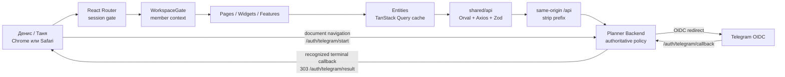
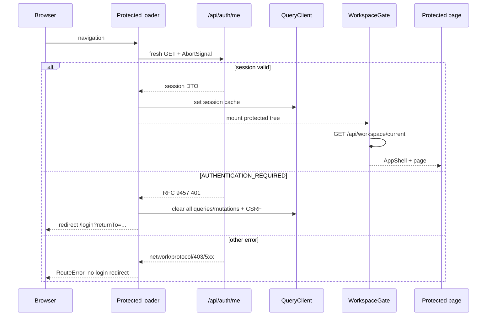
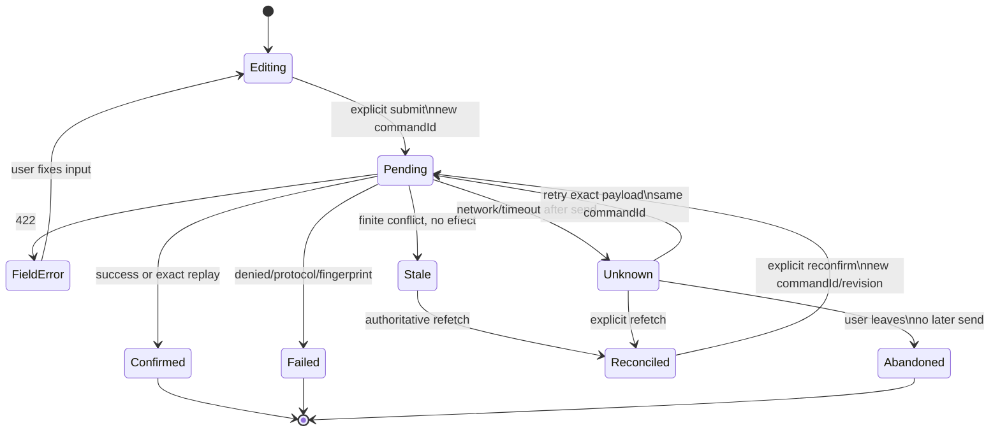

# Технический дизайн Planner Frontend

- **Версия:** 1.1
- **Дата:** 24 августа 2026 года
- **Статус:** `M1` foundation находится в review; frontend OpenAPI consumer
  закреплён на published backend handoff `F10`

## 1. Назначение и граница

Planner Frontend — отдельное React-приложение полного web-пилота,
зафиксированного в [PRD](./PRD.md), [user flows](./USER_FLOWS.md),
[карте экранов](./SCREEN_MAP.md) и [API coverage](./API_COVERAGE.md).
Технический дизайн описывает весь путь `UF-01…UF-08` и surfaces
`W-01…W-15`, включая целевые backend capabilities `F01…F10`.

Frontend отвечает за:

- безопасную browser-сессию и Telegram OIDC presentation;
- маршрутизацию, responsive-композицию и доступность;
- формы и подтверждения пользовательских намерений;
- OpenAPI-generated transport, server-state cache и recovery;
- точное отображение server-owned planning, tracking, reminder и reporting
  read models;
- локальные source gates и явно отделённую ручную browser-приёмку.

Backend остаётся единственным владельцем:

- identity, membership, persona mapping и authorization;
- lifecycle месяца, календарей, applicable expectations и allowed actions;
- draft/publication revisions, blockers, progress и scoring;
- идемпотентности commands, history, corrections и reports;
- reminder relevance и Telegram delivery;
- всех решений, способных изменить продуктовый результат.

Frontend не пересчитывает эти правила, не выводит их из UUID или порядка
массивов и не компенсирует отсутствующий HTTP-контракт локальной бизнес-логикой.

### 1.1. Не входит в этот дизайн

- production hosting, DNS, TLS и выбор домена;
- OCI/GHCR, Compose, Caddy, Dokploy и release promotion;
- автоматизированный browser E2E/Playwright;
- внешняя frontend telemetry, включая Sentry;
- PWA, service worker, persisted query cache и offline command queue;
- WebSocket/SSE/realtime между вкладками, web и Telegram;
- Telegram-редактор планов и callback/wizard implementation;
- перенос password/self-service auth, admin и `approval-requests` из starter;
- task-by-task frontend implementation plan.

Дизайн фиксирует обязательный browser transport interface. Конкретный ingress,
который реализует этот interface, проектируется отдельно.

## 2. Provenance и граница доказательств

### 2.1. Проверенный baseline

| Репозиторий                 | Проверенное состояние                                                                                | Роль                                                     |
| --------------------------- | ---------------------------------------------------------------------------------------------------- | -------------------------------------------------------- |
| `planner-frontend`          | branch `feat/m1-frontend-foundation`; commits `48c4de5`, `e31b927`, `0c4ea8b`, `23dab01` плюс текущий F10 repin | M1 implementation в review и owning consumer pipeline   |
| `react-starter`             | clean `stage=origin/stage=258b4e0a21022fc0894701e52885fd39b40469ee`                                  | Read-only foundation source                              |
| `planner-backend` published | `origin/main=ef76210ad66d442704417addfcf54e7f68cab65d`                                               | Published `F01…F09` и canonical OpenAPI для F10 handoff |

`openapi/source.json` закрепляет backend revision
`ef76210ad66d442704417addfcf54e7f68cab65d` и exact SHA-256
`ed80c89d36296750da11f68f4597a732a8e4e08f82f2e81a6ba8369dd2a9a625`.
Default `api:sync` получил artifact по immutable GitHub raw URL; локальный
sibling checkout не является альтернативным источником pin.

### 2.2. Уровни доказательств

| Уровень                       | Что доказывает                                                      | Чего не доказывает                  |
| ----------------------------- | ------------------------------------------------------------------- | ----------------------------------- |
| Technical design              | Решения полны и согласованы с product/API baselines                 | Наличие frontend-кода               |
| Source review                 | Структура, imports и contracts согласованы                          | Исполняемость                       |
| Local `pnpm check`            | Generated drift, format, lint, FSD, tests и build текущего checkout | GitHub CI, browser, backend runtime |
| GitHub source-check           | Тот же gate прошёл на конкретном hosted commit                      | Browser, deployment                 |
| Ручная local browser-проверка | Поведение конкретных локальных процессов и устройств                | Hosted routing/OIDC                 |
| Backend F10 handoff           | Published SHA, exact OpenAPI bytes и regeneration                   | Deployment                          |
| Hosted pilot smoke            | Конкретный HTTPS origin, OIDC/session/API/worker path               | Другие окружения                    |

Ни один нижний уровень не должен называться доказательством следующего.

## 3. Foundation и технологический контракт

### 3.1. Стратегия переноса `react-starter`

`react-starter@258b4e0` используется как read-only source механизмов, а не как
вторая Git history и не как runtime dependency.

В существующий `planner-frontend` переносятся и адаптируются:

- toolchain: package manager contract, TypeScript, Vite, ESLint, Prettier,
  Vitest и Steiger;
- app composition: entrypoint, providers, React Router Data Mode и route error
  boundary;
- shared transport: Axios, in-memory CSRF, Problem Details normalization и
  Orval mutator;
- committed OpenAPI snapshot, TypeScript/Zod generation и drift gates;
- TanStack Query ownership patterns;
- `useZodForm`, testing helpers и MSW foundation;
- Base UI/shadcn shared controls, Tailwind tokens, Inter и AppShell patterns.

Не переносятся как product source:

- password login, registration, email verification/reset и invitations;
- account administration;
- `approval-requests` entities/features/pages/routes;
- starter dashboard и product labels;
- Dockerfile, Compose, Caddy, OCI scripts/workflows и deployment runbooks;
- historical `docs/superpowers/**` и local tool state.

Текущие `PRD.md`, `USER_FLOWS.md`, `SCREEN_MAP.md` и `API_COVERAGE.md` не
перезаписываются. Новый repository не инициализируется, submodule/subtree не
создаётся, unrelated histories не сливаются. Будущий перенос улучшений starter
выполняется отдельным осознанным diff с новым exact source SHA.

### 3.2. Стек

Manifest specifiers и lockfile переносятся из exact
`react-starter@258b4e0` без dependency update. Manifest задаёт допустимый
контракт, lockfile — реально устанавливаемую версию.

| Область      | Manifest contract                                                                                  | Resolved starter lockfile / target                 |
| ------------ | -------------------------------------------------------------------------------------------------- | -------------------------------------------------- |
| Runtime      | Node.js `>=24 <25`, pnpm `11.15.1`                                                                 | pnpm `11.15.1`                                     |
| UI           | React `^19.2.7`, React DOM `^19.2.7`                                                               | `19.2.8`, `19.2.8`                                 |
| Build        | Vite `^8.1.1`, TypeScript `~6.0.2`                                                                 | `8.1.5`, `6.0.3`                                   |
| Routing      | React Router `8.3.0`, Data Mode                                                                    | `8.3.0`                                            |
| Server state | TanStack Query `^5.101.4`                                                                          | `5.101.4`                                          |
| HTTP         | Axios `1.18.1`                                                                                     | `1.18.1`                                           |
| Contracts    | Orval `8.23.0`, Zod `^4.4.3`                                                                       | `8.23.0`, `4.4.3`                                  |
| Forms        | React Hook Form `^7.83.0`, `@hookform/resolvers` `^5.5.7`                                          | `7.83.0`, `5.5.7`                                  |
| Styles/UI    | Tailwind CSS `^4.3.3`, shadcn `^4.15.0`, Base UI `^1.6.0`, Lucide `^1.27.0`, Lyra/Inter            | `4.3.3`, `4.15.0`, `1.6.0`, `1.27.0`               |
| Dates        | Planner addition: `date-fns@4.4.0`, `@date-fns/tz@1.5.0`                                           | Добавляются отдельно без update остальных packages |
| Charts       | Planner addition: `recharts@3.10.1` через project-owned primitives                                 | Добавляется отдельно                               |
| Architecture | Feature-Sliced Design, Steiger `0.6.0`                                                             | Steiger `0.6.0`                                    |
| Tests        | Vitest `4.1.10`, MSW `2.15.0`, jsdom `29.1.1`, Testing Library/user-event exact starter specifiers | `4.1.10`, `2.15.0`, `29.1.1`                       |

Новые versions или библиотеки требуют отдельной проверки совместимости и
lockfile diff. Playwright намеренно отсутствует в первом baseline.

## 4. Системная архитектура



Ошибки до распознавания и binding callback-запроса остаются прямыми Problem
Details responses и не являются terminal OIDC outcome.

### 4.1. Runtime path

```text
src/main.tsx
→ app/entrypoint
→ React StrictMode
→ AppProvider
   ├── QueryClientProvider
   ├── OnlineStatusProvider
   └── RouterProvider
→ protected parent loader
→ WorkspaceGate
→ AppShell
→ page/widget/feature
```

Единый `QueryClient` используется loader, entities и features. App-wide
providers принадлежат `app/config`; page не создаёт собственный cache или
transport.

## 5. Feature-Sliced Design и ownership

```text
app → pages → widgets → features → entities → shared
```

| Слой       | Целевые slices                                                                                                                                               | Ответственность                                            |
| ---------- | ------------------------------------------------------------------------------------------------------------------------------------------------------------ | ---------------------------------------------------------- |
| `app`      | `entrypoint`, `config`, `router`, global styles                                                                                                              | Composition root, providers, route tree, global boundaries |
| `pages`    | login, home-resolver, today, month, day, plans, plan-create, draft-editor, goal-form, publication-preview, catalog, catalog-definition, statistics, settings | URL-specific composition                                   |
| `widgets`  | `app-shell`, `workspace-gate`, reusable day/goal/report compositions                                                                                         | Крупная application-композиция без transport               |
| `features` | Telegram login/logout, create/copy/edit/publish/cancel plan, catalog actions, fact entry/maintenance, CloseDay, reminders, reopen/reclose                    | Одно пользовательское действие и mutation orchestration    |
| `entities` | session, workspace, plan-month, plan-draft, publication, goal-definition, tracking, reminder-settings, telegram-navigation, report, audit-history            | Query identity, cache, read presentation                   |
| `shared`   | API, config, routes, form/date/command helpers, UI, testing                                                                                                  | Технические механизмы без product use case                 |

Правила:

1. Slice потребляется только через `index.ts`.
2. Page не импортирует generated API hooks и не владеет query key.
3. Entity не владеет route composition или пользовательским workflow.
4. Feature не создаёт общий HTTP client, глобальный store или параллельный
   entity cache.
5. `shared` не знает о month lifecycle, goal type или persona.
6. Параллельный `src/modules` не создаётся.
7. Steiger проверяет границы handwritten source; generated output исключён.

## 6. Маршрутизация

### 6.1. Каноническое дерево

```text
createBrowserRouter
├── /login                                      W-01, public
├── /auth/telegram/result                       W-01, public
└── /                                           protected parent
    ├── index                                   server-state resolver
    ├── today                                   W-02 + W-03/W-04
    ├── months/:targetMonth                     W-05
    ├── months/:targetMonth/days/:localDate     W-06 + W-03
    ├── plans                                   W-07
    ├── plans/new                               W-08
    ├── plans/:targetMonth/edit                 W-09
    ├── plans/:targetMonth/goals/new            W-10
    ├── plans/:targetMonth/goals/:planGoalId/edit
    │                                           W-10
    ├── plans/:targetMonth/preview              W-11
    ├── plans/catalog                           W-12
    ├── plans/catalog/new                       W-10/W-12
    ├── plans/catalog/:goalDefinitionId         W-10/W-12
    ├── plans/catalog/:goalDefinitionId/new-version
    │                                           W-10/W-12
    ├── statistics/:targetMonth                 W-13 + W-15
    └── settings                                W-14
```

Route builders и parsers находятся в `shared/routes`. `targetMonth`,
`localDate` и UUID params валидируются generated Zod path schemas или общими
canonical value schemas до вызова API. Невалидный URL показывает local safe
not-found, не отправляя guessed request.

### 6.2. Secondary surfaces

- W03 entry/correction/delete/undo открывается как Sheet на узком viewport и
  Dialog/inline panel на desktop из Today или Day details. Источник данных
  остаётся родительским day read model; отдельный deep link не обещается.
- W04 CloseDay — `AlertDialog` с server preview, затем отдельной confirm
  mutation.
- W15 reopen — `AlertDialog`/form с обязательной причиной внутри Statistics.
- W10 является отдельной route-level страницей: форма слишком велика для
  безопасного dialog lifecycle и должна переживать reload/back navigation.

### 6.3. Root resolver

`/` не содержит dashboard. После session/workspace gates page получает
`GET /tracking/today` и выполняет replace-navigation:

| Server state          | Destination                                          |
| --------------------- | ---------------------------------------------------- |
| active `published`    | `/today`                                             |
| `no_plan` или `draft` | `/plans` или exact draft editor из authoritative ref |
| future `published`    | `/plans`                                             |
| `grace`/`closed`      | `/statistics/:targetMonth`                           |

Если доступен одноразовый safe `returnTo`, resolver сначала потребляет его и
открывает этот route. Конкретная page всё равно проверяет доступ через backend;
return target не даёт authorization.

## 7. Auth, session и `returnTo`

### 7.1. Protected session flow



Session decision всегда использует свежий `/api/auth/me`; cached session не
доказывает валидность cookie. Loader передаёт `request.signal`, а отменённый
request не очищает cache и не записывает устаревший результат.

Только stable code `AUTHENTICATION_REQUIRED`:

- очищает весь QueryClient предыдущего principal;
- очищает in-memory CSRF;
- скрывает protected UI;
- ведёт на `/login` с safe `returnTo`.

`AUTHORIZATION_DENIED`, workspace conflict, dependency/network и protocol
errors остаются отдельными состояниями.

### 7.2. Telegram OIDC

Кнопка «Продолжить через Telegram» выполняет document navigation на
`/auth/telegram/start`. Frontend не вызывает start через Axios и не читает
OIDC `state`, `code`, nonce, PKCE verifier, provider token или session cookie.

После F08 любой распознанный terminal callback, включая success, cancel,
denied identity, invalid/expired ceremony и временную недоступность dependency,
получает фиксированный redirect
`/auth/telegram/result?result=<finite-code>`. Raw Problem response не является
конечным UX document navigation. Finite enum является частью published OpenAPI
contract и генерируется вместе с frontend schemas. Result page:

- принимает только generated backend allowlist;
- неизвестный/повторённый query показывает общий safe result;
- не выводит provider payload или raw Problem `detail`;
- предлагает новый start, который создаёт новую ceremony;
- redirect-ит действующую session на `/`.

### 7.3. Одноразовый `returnTo`

OIDC использует full-page navigation, поэтому memory state SPA не переживает
ceremony. Допускается ровно одна запись `sessionStorage`:

```text
key: planner.return-to.v1
value: pathname
```

Правила sanitizer:

- длина не более 2048 UTF-16 code units;
- значение начинается с одного `/`, но не `//`;
- URL origin не допускается;
- `?query` и `#hash` не сохраняются и отклоняются sanitizer;
- `/login`, `/auth/telegram/result`, `/auth/telegram/start` и callback не
  являются targets;
- target должен соответствовать одному protected route family;
- запись создаётся только при явном start click;
- после успешной session проверки значение читается и удаляется до navigation;
- logout, invalid value и отказ login удаляют запись;
- token, form data, DTO, commandId и PII в storage не попадают.

Если будущей feature понадобится восстановление query/filter state, она
сначала добавляет отдельный route-specific allowlist и обновляет security tests;
generic сохранение `search/hash` не включается.

## 8. Browser transport

Planner backend OpenAPI публикует paths без `/v1`, а SPA владеет route
`/auth/telegram/result`. Поэтому broad `/auth/*` proxy недопустим.

### 8.1. Route table

| Browser path                    | Владелец         | Преобразование                                                     |
| ------------------------------- | ---------------- | ------------------------------------------------------------------ |
| `/api/*`                        | Backend JSON API | Удалить `/api`, например `/api/tracking/today` → `/tracking/today` |
| exact `/auth/telegram/start`    | Backend OIDC     | Без rewrite                                                        |
| exact `/auth/telegram/callback` | Backend OIDC     | Без rewrite                                                        |
| `/auth/telegram/result`         | Frontend SPA     | Никогда не proxy-ровать                                            |
| остальные paths                 | Frontend SPA     | Static asset либо SPA fallback                                     |

`API_AXIOS_INSTANCE` использует:

```text
baseURL = /api
withCredentials = true
```

Orval-generated `/auth/me` автоматически становится browser request
`/api/auth/me`; generated source и OpenAPI path при этом не изменяются.

Vite `server.proxy`:

- proxy-рует `^/api(?:/|$)` и удаляет только первый `/api`;
- отдельно proxy-рует exact regex для `start|callback`;
- не использует broad `/auth` matcher;
- получает backend origin только из server-side `DEV_API_PROXY_TARGET`;
- не помещает backend origin в production bundle.

Production ingress обязан воспроизвести таблицу, но его технология и
конфигурация находятся вне этого дизайна.

### 8.2. Cookie и CSRF

- Session cookie opaque и HttpOnly; frontend не читает token.
- Все requests credentialed и same-origin.
- Unsafe `POST/PUT/PATCH/DELETE` имеют exact JSON content type.
- Отсутствующий unsafe body нормализуется в `{}`.
- До unsafe request transport получает `/api/auth/csrf` и добавляет
  `X-CSRF-Token`.
- CSRF хранится только в памяти модуля; concurrent fetch разделяет один
  promise, generation guard блокирует stale token write.
- В Planner нет public unsafe auth mutations: OIDC start/callback — GET.
  Поэтому password-auth exemptions starter удаляются, а logout требует CSRF.
- Logout и authentication loss очищают CSRF и весь private QueryClient.

## 9. OpenAPI handoff и generation

### 9.1. Source of truth

```text
published planner-backend Git SHA
→ exact docs/api/openapi.json bytes
→ openapi/source.json + openapi/openapi.json
→ Orval TypeScript/Zod
→ shared/api curated exports
→ entities/features
```

До F10 локальный sibling file является исследовательским input, но не
implementation pin.

### 9.2. Pinned manifest

`openapi/source.json` имеет закрытую tracked schema:

```json
{
  "schemaVersion": "planner.openapi-source.v1",
  "repository": "https://github.com/DenisChernykh/planner",
  "revision": "<40 lowercase hex>",
  "artifactPath": "docs/api/openapi.json",
  "sha256": "<64 lowercase hex>"
}
```

Default `api:sync` строит raw URL из manifest, загружает exact revision,
считает SHA-256 по исходным bytes до JSON parsing и byte-for-byte записывает
snapshot без добавления, удаления или нормализации trailing newline.

`OPENAPI_SPEC_SOURCE` допускает локальный path, `file:` или HTTPS только как
явный override. Его bytes обязаны совпасть с manifest checksum. Обновление pin
выполняется отдельной `api:pin` operation, которая принимает published full SHA,
получает artifact, вычисляет checksum, обновляет manifest/snapshot и показывает
reviewable diff. Unpublished local commit не принимается F10 gate.

`openapi/required-operations.json` после F10 фиксирует method, path и exact
`operationId` для всех `W-01…W-15`. Operation IDs не придумываются frontend:
они копируются из canonical published artifact.

### 9.3. Commands

| Команда             | Контракт                                                                             |
| ------------------- | ------------------------------------------------------------------------------------ |
| `pnpm api:sync`     | Проверить manifest/source/checksum/required operations и обновить snapshot           |
| `pnpm api:generate` | Clean-generate TypeScript и Zod из committed snapshot                                |
| `pnpm api:update`   | Последовательно sync + generate                                                      |
| `pnpm api:check`    | Проверить manifest checksum, regenerate и отсутствие staged/unstaged/untracked drift |

`api:check` проверяет exact paths:

- `openapi/source.json`;
- `openapi/required-operations.json`;
- `openapi/openapi.json`;
- `src/shared/api/generated/**`;
- `src/shared/api/generated-zod/**`.

Проверка только `git diff --exit-code` недостаточна, потому что она не видит
новые untracked generated files.

### 9.4. Orval outputs

Один snapshot создаёт два clean outputs:

1. `client: react-query`, `httpClient: axios`, `mode: tags-split`, TanStack
   Query v5, `signal: true`, custom `apiMutator`;
2. `client: zod`, `mode: tags-split`, Zod 4 strict schemas для response, body,
   path, query и headers, отдельное `.zod.ts` расширение.

Generated source коммитится, не редактируется вручную и не является public API
pages. `shared/api/index.ts` экспортирует только используемые operations, DTO,
query helpers и schemas.

Каждый успешный HTTP response перед записью в Query cache проходит
operation-specific generated Zod schema. Несоответствие успешного payload
published contract преобразуется в `ApiProtocolError`; непроверенный response
не попадает в entity cache и не отображается как partial success. Generated
TypeScript types не заменяют эту runtime validation.

## 10. Error contract

### 10.1. Transport classes

```text
Axios error
├── response absent             → ApiNetworkError
├── invalid media/body/status   → ApiProtocolError
└── valid application/problem+json
    → ApiProblemError
       ├── status
       ├── stable code
       ├── requestId
       ├── retryAfterMs
       └── known extensions
```

Base RFC 9457 schema требует `type`, `title`, `status`, `detail`, `instance`,
`code` и `requestId`. Transport сохраняет только известные extension keys:
`errors`, `conflict`, `blockers`. Другие keys отбрасываются и никогда не
логируются.

Base envelope валидируется общим schema, а feature перед использованием
extension повторно разбирает весь problem operation-specific generated Zod
schema. Невалидный обязательный extension считается protocol failure, а не
частично доверенным domain conflict.

### 10.2. Presentation policy

- UI ветвится по stable `code`, status и валидированному extension.
- Raw `title`/`detail` не становятся пользовательским сообщением.
- `requestId` можно показать и скопировать для диагностики.
- Feature определяет allowlist JSON pointers и finite `nextAction`.
- Неизвестный pointer не привязывается к случайному полю; он даёт safe form
  summary с `requestId`.
- `429` показывает server-provided safe retry time, но не повторяет mutation
  автоматически.
- Unknown code получает локализованный safe fallback.

| Failure                       | UI и recovery                                                                             |
| ----------------------------- | ----------------------------------------------------------------------------------------- |
| `401 AUTHENTICATION_REQUIRED` | Global session/CSRF/cache clear, `/login`                                                 |
| `403`                         | Read-only/denied без login redirect и без entity disclosure                               |
| `404`                         | Контекстное empty/not-found, затем authoritative navigation                               |
| `409` stale                   | Refetch; исходный intent завершён без effect; новое подтверждение создаёт новый commandId |
| `409` exact replay            | Считать подтверждением исходного intent по server response                                |
| `409` fingerprint conflict    | Не повторять; показать safe conflict и refetch                                            |
| `422`                         | Сохранить form input, применить только pointer allowlist                                  |
| `429`                         | Показать cooldown; новый submit только пользователем                                      |
| `5xx` query                   | Общая bounded retry policy                                                                |
| Network mutation              | Unknown outcome; manual retry тем же payload/commandId или refetch                        |
| Protocol                      | Safe error, requestId если base был валиден; raw body скрыт                               |

## 11. Query cache и consistency

### 11.1. QueryClient defaults

Queries:

- максимум две retry attempts только для network error и валидного Problem
  `5xx`;
- protocol, `4xx` и aborted requests не повторяются;
- global `refetchOnWindowFocus=false`; live entities включают его явно;
- Axios получает TanStack Query `AbortSignal`.

Mutations:

- `retry=false`;
- `networkMode="always"`, чтобы TanStack Query не ставил mutation в paused
  queue и не возобновлял её автоматически;
- feature до `mutate` проверяет app online state и блокирует новый submit
  offline;
- network false-positive всё равно завершается `ApiNetworkError` и manual
  reconciliation, а не background resume.

### 11.2. Query classes

| Entity              | Identity                          | Freshness/reload                                             |
| ------------------- | --------------------------------- | ------------------------------------------------------------ |
| Session             | singleton                         | Fresh loader на auth decision; cache только для presentation |
| Workspace           | singleton per principal           | Refetch focus/reconnect и после seed persona binding         |
| Plan month index    | page/cursor                       | Refetch focus/reconnect и после lifecycle/draft changes      |
| Draft               | `targetMonth`/`planMonthId`       | Live, revision-bound; refetch focus/reconnect                |
| Publication         | `publicationId`                   | Immutable; `staleTime=Infinity` после успешного read         |
| Catalog list        | state/page                        | Invalidate catalog mutations; focus refetch не обязателен    |
| Catalog detail      | `goalDefinitionId`                | Invalidate version/archive/restore/copy                      |
| Today               | active local date/current context | Refetch focus/reconnect                                      |
| Tracking month      | `targetMonth`                     | Refetch focus/reconnect и after fact/lifecycle mutation      |
| Reminder settings   | current member                    | Refetch reconnect and after save                             |
| Delivery/navigation | current member/config             | Refetch focus/reconnect                                      |
| Report              | `targetMonth`                     | Refetch focus/reconnect and after fact/lifecycle mutation    |
| Fact history        | `factRecordId` + cursor           | Invalidate after correction/delete/undo                      |
| Month history       | `planMonthId` + cursor            | Invalidate after publish/cancel/reopen/reclose               |

Entity cache keys delegate generated query-key helpers where available. UUID в
key canonical lowercase; HTTP path сохраняет validated route value. Response
identity проверяется до cache write.

### 11.3. Mutation effects

| Mutation family                              | Cache action после confirmed response                                                                        |
| -------------------------------------------- | ------------------------------------------------------------------------------------------------------------ |
| Catalog create/version/copy/archive/restore  | Записать returned detail/ref; invalidate affected list/detail                                                |
| Draft create/add/update/remove/reorder/focus | Записать full draft если он возвращён, иначе refetch draft; invalidate preview and month index               |
| Publish                                      | Записать publication ref/snapshot; invalidate draft, month index, Today, target month, report, month history |
| Cancel/republish                             | Invalidate month index, draft/publication refs, Today/month/report/history                                   |
| Fact record/correct/delete/undo              | Reconcile exact response, затем refetch Today и target month; invalidate report и fact history               |
| CloseDay/weekly task                         | Refetch Today/month; invalidate report и affected histories                                                  |
| Reminder save                                | Записать exact settings response; не менять partner cache                                                    |
| Reopen/reclose                               | Refetch report/month/index; invalidate month history                                                         |

Broad `invalidateQueries()` без key запрещён, кроме principal change, где весь
QueryClient очищается намеренно.

## 12. Mutation intent protocol



Один explicit intent получает lowercase UUID через `crypto.randomUUID()` до
первого request. Feature хранит в памяти exact payload и commandId до terminal
response или явного отказа.

- Pending блокирует повторный submit.
- Unknown retry использует byte-equivalent payload и тот же commandId.
- Stale response является известным non-effect. После refetch пользователь
  подтверждает новый intent с новой revision и новым commandId.
- Изменение payload при том же commandId запрещено.
- Intent не попадает в local/session storage, Query persistence или telemetry.
- При попытке уйти из pending/unknown surface показывается явный blocker. Если
  пользователь всё же уходит, automatic later send отсутствует.
- Success показывается только после server confirmation и обязательной cache
  reconciliation.

Optimistic fact, publication, CloseDay или lifecycle state запрещены.

## 13. Dates, time и lossless values

Canonical wire values остаются строками:

| Тип                     | Representation                  |
| ----------------------- | ------------------------------- |
| Month                   | `YYYY-MM`                       |
| Product date            | `YYYY-MM-DD`                    |
| Local time              | `HH:mm`                         |
| Instant                 | ISO date-time string            |
| Revision/counter/bigint | canonical decimal string        |
| Exact decimal/ratio     | backend string/structured ratio |

Правила:

- `new Date("YYYY-MM-DD")` запрещён из-за UTC interpretation.
- Local date разбирается на year/month/day и создаётся через `TZDate` с explicit
  `Asia/Yekaterinburg` только для calendar arithmetic/formatting.
- Instants форматируются через explicit product timezone; browser timezone не
  влияет на expectation date.
- `HH:mm` отправляется без преобразования в instant.
- Date labels используют русскую locale из `date-fns`; backend value остаётся
  неизменным cache source.
- Revision/decimal strings не проходят через `Number`, `parseInt`, unary `+`
  или HTML `valueAsNumber` в product model.
- Chart adapter может создать bounded finite `number` только для pixel
  coordinate после schema/range check. Tooltip, таблица, equality, sorting и
  business decisions используют exact source value.

## 14. Forms и UI actions

`useZodForm` из starter — общий typed RHF adapter. Generated request schema
валидирует wire contract; feature-owned UI schema допустима, когда progressive
form state отличается от DTO.

```text
user-facing form model
→ feature Zod validation
→ explicit mapping
→ generated request DTO validation
→ mutation intent
```

UI form model не называется DTO и не используется transport напрямую.

### 14.1. Общие правила

- Decimal inputs — text/inputMode controls со string validation.
- Time — `input type="time"`, но value остаётся `HH:mm`.
- Conditional goal sections монтируются по selected backend type/repetition;
  скрытые поля не отправляются.
- Known server pointers mapped к RHF field paths через feature allowlist.
- Unsaved route-level form использует React Router blocker с вариантами
  остаться или явно потерять изменения.
- Reorder имеет кнопки «выше/ниже» и keyboard/touch path; drag-only UI
  запрещён. Mutation отправляет full authoritative ordered ID set.
- Publish, cancel, CloseDay, reopen и reclose используют server preview либо
  явное consequences confirmation.
- Partner personal goals видимы, но mutation controls отсутствуют или disabled
  с объяснением; backend всё равно проверяет право.

### 14.2. Typed goal/input matrix

Conditional form и тестовые fixtures строятся по явной product-матрице, а не
по одному универсальному value control:

| Family                 | Конфигурация `W-10`                                     | Ввод `W-03` / operation family                                                                        |
| ---------------------- | ------------------------------------------------------- | ----------------------------------------------------------------------------------------------------- |
| Boolean                | owner, repetition, scoring mode                         | `done/not_done` → `POST /tracking/facts`                                                              |
| Quantity targeted      | target, unit, precision, `add/latest`                   | decimal string → `POST /tracking/facts`                                                               |
| Quantity informational | unit, precision, без target/score                       | decimal string → `POST /tracking/facts`                                                               |
| Actual time            | local range, включая переход через полночь              | local date + `HH:mm` → `POST /tracking/facts/time`                                                    |
| Rating                 | server range и applicable checkpoint                    | rating value → `POST /tracking/facts/rating`                                                          |
| Text                   | result semantics и non-empty constraint                 | text + result → `POST /tracking/facts/text`                                                           |
| Checklist              | stable items, ordering, applicability                   | item → `POST /tracking/facts/checklist-item`; flexible occurrence → composite operation               |
| OR variants            | stable variants и typed child values                    | variant → `POST /tracking/facts/or-variant`; flexible occurrence → composite operation                |
| Checkpoints            | stable components, `independent/all`, собственные сроки | scalar component → `POST /tracking/facts/checkpoint`; typed child использует свой generated operation |
| Weekly planned task    | конкретная calendar week, без daily expectation         | result → publication weekly-task operation                                                            |

Repetition fixtures покрывают daily, selected weekdays, exact `N` per calendar
week, exact `N` per month, one-off local date и weekly planned task. Матрица не
разрешает невозможный cross-product: generated discriminated schema определяет
applicable fields и exact request DTO, а backend остаётся владельцем
applicability, prorating и evaluation.

## 15. Visual foundation, responsive и accessibility

### 15.1. Shared UI

Основа — shadcn source на Base UI, стиль Lyra, Inter и Tailwind tokens.
Обязательные starter primitives:

- `Button` и `Button isLoading`;
- `TextField`, `TextareaField`, form field composition;
- `Alert`, `AlertDialog`, `Sheet`, `Sidebar`, `Badge`, `Tooltip`;
- `Container`, `Skeleton`, `Spinner`, separators.

Новые повторяемые contracts сначала создаются в `shared/ui` с тестом. Base UI
использует `render`, а не Radix `asChild`.

Planner добавляет semantic token pairs с foreground:

- `status-success`, `status-danger`, `status-warning`, `status-info`,
  `status-muted`;
- `scope-personal`, `scope-shared`, `scope-partner`.

Конкретные OKLCH values проходят WCAG AA и визуальную проверку. Семантика
дублируется текстом/иконкой; цвет не является единственным сигналом.

### 15.2. AppShell

- Desktop: sidebar с четырьмя destinations, header month/lifecycle context и
  account menu.
- Mobile: Sheet navigation с теми же четырьмя destinations и actions.
- Settings и logout находятся в account menu, не образуют пятый primary item.
- В protected branch ровно один `<main>` принадлежит AppShell.
- Offline banner persistent и не перекрывает primary action/error.

### 15.3. Charts и heatmap

Recharts используется только через project-owned `shared/ui/chart` primitives.
Поддерживаются line/bar charts для server-provided series. Каждый chart имеет:

- visible title и единицы;
- keyboard-accessible surface;
- exact text/table alternative;
- non-hover path к значениям;
- `N/A` как отсутствие метрики, не ноль;
- reduced-motion compatible presentation.

Calendar heatmap реализуется семантической HTML/CSS grid/table, а не canvas.
Каждая ячейка содержит date, state и exact value в accessible name; legend
различает `done/not_done/no_data/not_applicable` текстом и иконкой.

### 15.4. Browser matrix

Blocking manual pilot matrix:

- актуальный stable Chrome на macOS desktop;
- актуальный Safari на реальном iPhone.

Functional parity означает одинаковые data/actions/recovery, но допускает
разную плотность и composition. Поворот, zoom, длинные русские подписи, touch
targets, keyboard focus, dialogs и text alternatives проверяются отдельно.

## 16. Online-only behavior

`OnlineStatusProvider` слушает browser `online/offline`, но этот сигнал не
считается гарантией backend reachability.

Offline:

- AppShell показывает persistent banner;
- unsafe controls disabled до explicit online transition;
- cached data остаётся видимым как stale/read-only;
- новые intents не создаются и не попадают в queue;
- forms остаются в памяти открытого component, но не считаются сохранёнными.

Reconnect:

- refetch session/workspace и активных live entities;
- ранее не отправленный form не submit-ится автоматически;
- unknown intent не повторяется автоматически;
- immutable publication cache не refetch-ится без invalidation.

## 17. Traceability `W-01…W-15`

| Surface                | Route/composition                      | Entity/feature                                     | HTTP capability / readiness                                   |
| ---------------------- | -------------------------------------- | -------------------------------------------------- | ------------------------------------------------------------- |
| W-01 Login             | `/login`, `/auth/telegram/result`      | session, telegram-login                            | start/callback/me/logout; F08 result redirect; F09 navigation |
| W-02 Today             | `/today`                               | workspace, tracking; fact/CloseDay entrypoints     | `GET /tracking/today`; F01 workspace                          |
| W-03 Entry/maintenance | Sheet/Dialog in Today/Day              | record-fact, correct/delete/undo                   | scalar/composite fact POSTs, correct/delete/undo              |
| W-04 CloseDay          | AlertDialog in Today                   | tracking, close-day                                | close-preview + close POST                                    |
| W-05 Month             | `/months/:targetMonth`                 | plan-month, tracking                               | `GET /tracking/months/:targetMonth`; F02 discovery            |
| W-06 Day details       | `/months/:targetMonth/days/:localDate` | tracking, audit-history                            | month read; F07 fact history                                  |
| W-07 Plans             | `/plans`                               | plan-month, publication                            | active/publication reads; F02 index, F06 cancel               |
| W-08 Create plan       | `/plans/new`                           | plan-month/plan-draft; create-plan                 | seed existing; F03 empty; F04 copy; F02 sources               |
| W-09 Draft editor      | `/plans/:targetMonth/edit`             | plan-draft; draft actions                          | editor/add/update/remove/reorder; F05 focus                   |
| W-10 Goal form         | goal/catalog routes                    | goal-definition, plan-draft                        | catalog create/version + draft add/update                     |
| W-11 Preview/publish   | `/plans/:targetMonth/preview`          | plan-draft, publication                            | preview/publish; F06 republish                                |
| W-12 Catalog           | `/plans/catalog/**`                    | goal-definition; catalog actions                   | list/detail/create/version/copy/archive/restore               |
| W-13 Statistics        | `/statistics/:targetMonth`             | report, plan-month, audit-history                  | report/reclose; F02 index, F07 history                        |
| W-14 Settings          | `/settings`                            | workspace, reminders, telegram-navigation, session | reminder settings/status, logout; F01/F09                     |
| W-15 Reopen            | AlertDialog in Statistics              | reopen-month, audit-history                        | reopen; F07 history                                           |

## 18. Traceability `UF-01…UF-08`

| Flow                                   | Frontend path                                          | Contract gate                                       |
| -------------------------------------- | ------------------------------------------------------ | --------------------------------------------------- |
| UF-01 OIDC/session                     | W-01 → root resolver → protected route; logout in W-14 | A03 + F01 + F08; F09 for bot link                   |
| UF-02 Create draft                     | W-07 → W-08 → W-09                                     | seed + F02/F03/F04                                  |
| UF-03 Catalog/edit/validation          | W-12/W-10 → W-09 → W-11 blockers                       | Existing catalog/draft + F01/F05                    |
| UF-04 Preview/publish/cancel/republish | W-09 → W-11 → W-02/W-07                                | Existing preview/publish + F06                      |
| UF-05 Daily loop                       | W-02/W-06 → W-03                                       | Existing tracking operations + F01/F07 labels/audit |
| UF-06 Month/day                        | W-05 → W-06 → W-03/W-13                                | Tracking month + F02/F07                            |
| UF-07 Reminders/CloseDay/weekly        | W-14 + W-02/W-04                                       | Existing reminders/maintenance + F09                |
| UF-08 Report/lifecycle/next month      | W-13/W-15 → W-08                                       | Existing report/reopen/reclose + F02/F04/F07        |

Ни один flow не объявляется complete, пока все его GAP operations находятся в
published pinned artifact и соответствующие surfaces прошли verification.

## 19. Backend readiness gates `F01…F10`

| Gate                     | Frontend use                                   | Текущее наблюдение                                    |
| ------------------------ | ---------------------------------------------- | ----------------------------------------------------- |
| F01 workspace context    | AppShell labels, owner choice, report sections | Published в pinned backend `ef76210`                  |
| F02 month discovery      | Plans/month/statistics navigation              | Published в pinned backend `ef76210`                  |
| F03 empty draft          | W-08                                           | Published в pinned backend `ef76210`                  |
| F04 publication copy     | W-08/next month                                | Published в pinned backend `ef76210`                  |
| F05 focus update         | W-09                                           | Published в pinned backend `ef76210`                  |
| F06 cancel/republish     | W-07/W-11                                      | Published в pinned backend `ef76210`                  |
| F07 fact/month histories | W-06/W-07/W-13/W-15                            | Published в pinned backend `ef76210`                  |
| F08 OIDC result redirect | W-01                                           | Published в pinned backend `ef76210`                  |
| F09 bot navigation       | W-01/W-14                                      | Published в pinned backend `ef76210`                  |
| F10 pinned handoff       | Reproducible consumer contract                 | Local gate/review passed; remote CI is separate evidence |

Foundation и независимые UI primitives могут разрабатываться раньше F10, но
никакая GAP-dependent feature не получает статус ready на основе локального
application command, guessed DTO или unpublished OpenAPI.

## 20. Verification strategy

### 20.1. Automated source gate

Целевой `pnpm check` выполняет последовательно:

```text
api:check
→ format:check
→ eslint
→ steiger architecture
→ vitest
→ TypeScript + Vite production build
```

TSDoc не входит в gate и выполняется только отдельной задачей, как в starter.

Обязательный GitHub source-check workflow использует repository-owned Node/pnpm
contract, выполняет clean reproducible install и запускает тот же
`pnpm check`. Workflow не задаёт конфликтующую версию pnpm. Local pass и hosted
CI pass фиксируются как разные evidence claims.

### 20.2. Test ownership

| Уровень                 | Что проверяется                                                                                     |
| ----------------------- | --------------------------------------------------------------------------------------------------- |
| Shared unit             | sanitizer, returnTo, dates, exact-value presentation, command intent, Problem parsing, retry policy |
| Entity unit             | query key identity, options, cache writes/invalidation, live/immutable policies                     |
| Feature component + MSW | forms, pointer mapping, pending/unknown/stale/replay, permission/read-only UI                       |
| Page/router integration | protected/public matching, session-before-business ordering, root resolver, route errors            |
| AppShell integration    | navigation, offline banner, workspace labels, mobile Sheet semantics                                |
| Manual browser          | actual layout, focus, touch, charts, full W frame checklist                                         |

MSW handlers импортируют generated DTO types/public schemas и не создают
параллельный production contract. Fixtures содержат exact OpenAPI revision,
проверяются generated schemas и меняются reviewable вместе с pin. Они
доказывают frontend request mapping, presentation и recovery, но не backend
authorization, atomicity, persistence или domain policy.

### 20.3. Обязательные automated scenarios

1. Anonymous deep link → safe login redirect; abort не очищает новую session.
2. Только `AUTHENTICATION_REQUIRED` очищает QueryClient/CSRF.
3. Safe pathname-only `returnTo` переживает OIDC document navigation и
   consume-ится один раз; external/oversized/auth/query/hash targets отклоняются.
4. F08 finite result codes локализованы; unknown query не раскрывает raw data.
5. Workspace current/partner/shared labels не выводятся из UUID/array order.
6. Каждый family и repetition из §14.2 строит exact generated DTO без
   irrelevant fields и выбирает только соответствующий generated operation.
7. Decimal/revision/date/time остаются строками на model/transport boundary.
8. Same-tick duplicate submit создаёт один intent.
9. Network unknown retry повторяет exact payload/commandId; stale reconfirm
   создаёт новый commandId.
10. Offline submit не вызывает mutation и не resume-ится после reconnect.
11. Catalog/draft/publication/fact/lifecycle mutations меняют только нужный
    cache и выполняют authoritative refetch.
12. Partner write и shared delete недоступны; server denial не превращается в
    anonymous state.
13. `done/not_done/no_data/not_applicable` различаются текстом и accessible
    name.
14. Report `N/A`, exact table values и chart series не подменяются нулями.
15. Lifecycle `no_plan/draft/published/grace/closed/reopened` и report
    `current/preliminary ordinary/preliminary reopened/closed/revised` дают
    только server-allowed actions; `N/A` не превращается в zero score.
16. Field-pointer allowlist привязывает только известные поля; unknown pointer
    остаётся в safe summary с `requestId`.
17. Raw Problem `detail`, cookie, CSRF и Telegram identifiers отсутствуют в
    rendered UI/test diagnostics.
18. Exact OIDC start/callback proxy-руются в backend, `/api/*` теряет только
    первый `/api`, а `/auth/telegram/result` никогда не покидает SPA ownership.
19. Invalid successful response даёт `ApiProtocolError` и не записывается в
    Query cache.

### 20.4. Manual browser acceptance

До пилота создать отдельный evidence document и пройти все 16 frame groups из
`SCREEN_MAP.md` минимум на Chrome/macOS и Safari/iPhone. Проверка включает:

- login/callback/session expiry;
- четыре primary destinations и deep links;
- daily input/maintenance/CloseDay;
- month/day states;
- draft/goal/catalog/preview/publish;
- reminders и Telegram status;
- report/reopen/reclose;
- keyboard/focus, touch targets, zoom/orientation, reduced motion;
- chart/heatmap text alternatives;
- offline, unknown outcome и reconnect.

Это ручная browser evidence. Она не входит в `pnpm check` и не заменяет hosted
OIDC/session/API smoke.

## 21. Security, privacy и observability

- Browser storage содержит только одноразовый sanitized route; tokens и server
  data не сохраняются.
- Console, UI и tests не логируют raw response, form reason/text, cookie, CSRF,
  Telegram/member identifiers или OIDC data.
- External frontend telemetry отсутствует.
- Диагностика пользователю ограничена safe localized message и `requestId`.
- Product usage metrics выводятся из backend authoritative records, а не из
  client event analytics.
- `window.onerror`/unhandled rejection не отправляются наружу; browser failures
  воспроизводятся вручную и связываются с server requestId, когда он есть.
- CSP, TLS, HSTS и ingress logs относятся к отдельному delivery design.

## 22. Решения и assumptions

1. Target — полный `F01…F10`, а не урезанный current-API release.
2. Из starter переносится foundation, но не чужие product modules.
3. Delivery полностью отложен; transport path table является только обязательным
   interface будущего ingress.
4. Browser automation отложена; blocking browser matrix ручная.
5. Внешняя telemetry отсутствует.
6. `date-fns`/`@date-fns/tz` и Recharts — единственные Planner-specific runtime
   additions к starter baseline.
7. Frontend остаётся online-only и server-authoritative.
8. Любое изменение backend gap contract синхронно обновляет backend addendum,
   OpenAPI pin, этот документ и API coverage до feature implementation.
9. `F10`, frontend regeneration, source gate, browser acceptance и hosted
   deployment являются отдельными claims.
10. `G0` принят: exact-byte OpenAPI pin, runtime success validation,
    pathname-only `returnTo`, safe finite OIDC results, normative proxy table,
    обязательный GitHub source-check и revision-bound MSW fixtures являются
    частью implementation contract.
