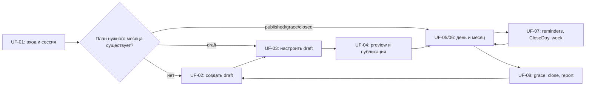

# User flows frontend-пилота Planner

**Версия:** 1.0
**Дата:** 24 августа 2026 года
**Статус:** продуктовая спецификация frontend-пилота
**Backend baseline:** `planner-backend@44f00d00715d6a485ad5aff3f36680a414af96ae`

## 1. Назначение и границы

Документ описывает путь Дениса и Тани в адаптивном online-only web Planner: от
Telegram OIDC-входа до закрытого или пересмотренного отчёта и создания плана на
следующий месяц. Это frontend-представление уже утверждённых правил backend, а
не новый источник бизнес-политики.

Веб предоставляет функциональный паритет на телефоне и desktop. Ежедневный
контур должен быть удобен на телефоне, а планирование — на большом экране, но
ни одно действие не может быть доступно только на одном размере экрана.
Документ фиксирует задачи, состояния и переходы, но не выбирает framework,
визуальный паттерн, component library или способ размещения интерфейса.

Telegram в этом документе используется как провайдер идентификации и канал
персональных напоминаний. Редактор плана и полный ежедневный web-контур не
зависят от Telegram-бота.

## 2. Общие правила всех flows

### 2.1. Backend-authoritative поведение

- Actor всегда определяется локальной web-сессией; frontend не передаёт actor ID
  от имени пользователя. Технические UUID никогда не хардкодятся и не служат
  подписями. Для personal goal поле `ownerMemberId` выбирается только из
  backend-provided mapping `GAP-01` и отправляется как часть конфигурации цели.
- Имена участников, текущий member и соответствие persona должны поступать от
  backend. Telegram username не является идентификатором.
- После mutation интерфейс показывает подтверждённый backend результат и затем,
  когда это нужно экрану, перечитывает authoritative read model. Optimistic UI
  не выдаётся за сохранённое состояние.
- `draftRevision`, `planMonthRevision`, `lifecycleRevision`, `factsRevision`,
  `publicationRevision`, `scheduleRevision` и fact revisions остаются
  decimal strings. Frontend не преобразует их в JavaScript `number`.
- Ошибки читаются как `application/problem+json`: ветвление выполняется по
  стабильному `code`, field errors связываются по `errors[].pointer`, а
  `requestId` сохраняется для диагностики. `title` и `detail` не используются
  как машинный контракт.
- Unsafe-запросы используют session cookie, актуальный CSRF token из
  `GET /auth/csrf` и серверные Origin/CSRF-проверки.

### 2.2. Повторы, конфликты и обновление данных

- Один подтверждённый пользовательский intent получает один canonical UUID
  `commandId`. При повторе того же запроса после timeout или потери ответа
  frontend отправляет тот же payload с тем же `commandId`.
- Изменённый пользователем intent не маскируется под повтор прежнего запроса.
  Frontend создаёт новую команду либо следует точному recovery-контракту,
  возвращённому backend.
- Stale revision/hash или другой `409` не перезаписывает подтверждённые данные.
  Frontend выполняет refetch, показывает актуальное состояние и просит заново
  подтвердить действие, если оно всё ещё применимо.
- Realtime в пилоте нет. Изменения партнёра становятся видны после навигации,
  возврата фокуса, ручного обновления или обязательного refetch после команды;
  интерфейс не обещает мгновенную синхронизацию между двумя открытыми вкладками.

### 2.3. Сеть и сессия

- Пилот работает только online. При отсутствии сети ранее загруженное состояние
  можно оставить видимым с отметкой «Нет подключения», но нельзя подтверждать
  как актуальное или ставить mutations в скрытую offline-очередь.
- После восстановления сети пользователь явно повторяет read. Неоднозначно
  завершившаяся mutation повторяется с тем же `commandId` только после
  проверки её исходного payload.
- Любой защищённый запрос с `401 AUTHENTICATION_REQUIRED` завершает текущий
  flow переходом на `W-01`. После нового входа frontend перечитывает backend и
  не воспроизводит unsafe-запрос автоматически.
- Временные `503` и сетевые ошибки не меняют отображаемый доменный статус.
  Пользователь получает безопасное действие повтора.
- Все календарные границы и времена напоминаний интерпретируются backend в
  `Asia/Yekaterinburg`; frontend отображает эту timezone явно и не выводит
  lifecycle из локальных часов устройства.

### 2.4. Состояния и права

- Состояния месяца: `draft`, `published`, `grace`, `closed`; повторно открытый
  месяц определяется сочетанием `grace` и `lifecycleMode=reopened`.
- Состояния ожидания: `done`, `not_done`, `no_data`, `not_applicable`.
- Владелец personal-цели вносит и изменяет её факты; цель партнёра видна
  read-only. Shared-факты доступны обоим согласно backend-командам.
- Published snapshot неизменяем. Обычный `grace` и reopened `grace` разрешают
  только те corrections, которые допускает backend; конфигурация плана не
  разблокируется.

## 3. Обзор пути

## UF-01. Telegram OIDC, web-сессия и выход

### Цель

Безопасно связать браузер с одним allowlisted участником, восстановить
действующую сессию при повторном открытии и дать явный выход.

### Участники и устройства

- Денис или Таня;
- телефон или desktop-браузер;
- Telegram как OIDC provider.

### Предусловия

- Пространство пары и оба участника созданы backend.
- Stable numeric Telegram user IDs внесены в закрытый allowlist.
- На backend настроены Telegram OIDC и допустимый callback URI.

### Триггер

Пользователь открывает frontend без известного состояния сессии, возвращается
из Telegram callback либо выбирает «Выйти» в меню аккаунта.

### Основной путь

1. При bootstrap frontend вызывает `GET /auth/me` с cookie credentials.
2. При действующей сессии frontend принимает только возвращённый `userId` как
   identity текущего actor и загружает стартовое состояние через
   `GET /tracking/today`.
3. При `401` frontend открывает `W-01` и предлагает «Продолжить через Telegram».
4. Действие открывает `GET /auth/telegram/start`; backend создаёт OIDC ceremony
   и перенаправляет браузер в Telegram.
5. После подтверждения Telegram возвращает браузер на
   `GET /auth/telegram/callback`. Backend проверяет ceremony, verified claims и
   allowlist, создаёт локальную сессию и выполняет success redirect.
6. После возврата frontend снова вызывает `GET /auth/me`, затем
   `GET /tracking/today` и направляет пользователя в `W-02` либо `W-07` по
   authoritative состоянию `published`, `draft` или `no_plan`.
7. Перед первым unsafe-запросом frontend получает `GET /auth/csrf`.
8. При выходе frontend отправляет `POST /auth/logout` с session cookie и CSRF,
   после `204` открывает `W-01` и не сохраняет идентификаторы сессии как
   пользовательские данные.

### Альтернативы, ошибки и восстановление

- Отмена на стороне Telegram, invalid/expired ceremony, неверные claims или
  provider failure не создают сессию. Пользователь начинает новую ceremony.
- Telegram identity вне allowlist получает отказ без раскрытия данных
  пространства.
- Текущий callback возвращает Problem Details непосредственно. Для
  согласованного frontend-экрана ошибки нужен `GAP-08`.
- `GET /auth/me` возвращает только `userId` и `sessionId`; отображаемое имя,
  состав пары и persona нельзя безопасно вывести без
  `GAP-01`.
- При session expiry применяется общее правило `401`: переход на `W-01`, новый
  вход, затем полный refetch без автоматического повтора mutation.
- При offline кнопка входа и выход, требующий подтверждения backend, недоступны;
  интерфейс не изображает успешную OIDC ceremony.
- Deep link или публичные metadata личного бота не выводятся из константы;
  нужен `GAP-09`.

### Результирующее состояние

- Browser session однозначно связана с одним allowlisted member либо отсутствует.
- После входа загружено серверное стартовое состояние; после подтверждённого
  выхода защищённые данные больше не показываются как активная сессия.

### Поверхности

`W-01 Вход`, `W-14 Настройки/аккаунт`, затем `W-02 Сегодня`, `W-07 Планы` или
`W-13 Статистика` по текущему состоянию.

### API status

- Есть: `GET /auth/me` (`AuthController_me`),
  `GET /auth/telegram/start` (`startTelegramOidcLogin`),
  `GET /auth/telegram/callback` (`completeTelegramOidcLogin`),
  `GET /auth/csrf` (`AuthController_csrfToken`),
  `POST /auth/logout` (`AuthController_logout`).
- GAP: `GAP-08`, `GAP-01`,
  `GAP-09`.

### Acceptance

- Allowlisted участник входит и выходит на телефоне и desktop; неизвестный ID
  не получает локальную сессию.
- Повтор callback или просроченная ceremony не создают вторую сессию как
  побочный продукт frontend-повтора.
- Истёкшая сессия на любом flow приводит к повторному входу и refetch, а не к
  потере или скрытому повтору unsafe-команды.
- Frontend не хардкодит имена, member UUID, persona или Telegram username.

## UF-02. Создание draft из seed, пустого плана или копии

### Цель

Создать один редактируемый план выбранного календарного месяца из явно
выбранного источника и никогда не переносить факты прошлого месяца.

### Участники и устройства

- Денис или Таня с действующей web-сессией;
- телефон или desktop; на desktop сценарий может быть плотнее, но набор
  действий и результат одинаковы.

### Предусловия

- Для target month нет другого плана либо frontend готов открыть уже
  существующий.
- Для one-time seed пользователь может осознанно выбрать свою persona.
- Target month задаётся canonical `YYYY-MM`; допустимость определяет backend.

### Триггер

Пользователь выбирает «Создать план» или «Следующий месяц» в `W-07`/`W-13`.

### Основной путь

1. `W-08` предлагает target month и три продуктовых источника: one-time seed,
   пустой draft или копию выбранного прошлого месяца.
2. Для seed пользователь выбирает, какая persona исходного шаблона соответствует
   ему. Frontend отправляет `targetMonth`, `actorPersona` и новый `commandId` в
   `POST /planning/drafts/from-seed`.
3. Backend атомарно создаёт полностью заполненный draft revision `1`; frontend
   открывает его через `GET /planning/drafts?targetMonth=...`.
4. Для пустого draft backend должен создать месяц с обязательным focus и без
   целей. Этот путь остаётся контрактным GAP, пока нет отдельной operation.
5. Для копии пользователь выбирает source month. Backend должен перенести
   конфигурацию snapshots, линии целей и порядок, но не факты, статусы,
   coverage, результаты или вычисленный progress. Этот путь остаётся GAP.
6. После любого подтверждённого способа frontend открывает `W-09` и показывает
   только данные нового draft, полученные от backend.

### Альтернативы, ошибки и восстановление

- Если target month уже существует, frontend не создаёт дубликат: после
  `PLAN_MONTH_ALREADY_EXISTS` перечитывает этот месяц и открывает доступное
  состояние.
- Если seed уже использован, `PLAN_SEED_ALREADY_CONSUMED` убирает seed из
  текущего выбора после refetch; frontend не подменяет его пустым draft.
- Неоднозначный ответ на seed-create повторяется с теми же payload и
  `commandId`. Другой target month или persona — новый intent.
- Без сети create недоступен; локальный «draft» не создаётся.
- Пока нет API индекса, W-07 не может достоверно построить список всех месяцев
  и статусов. Это `GAP-02`; запрос одного известного
  `targetMonth` не считается заменой индекса.
- Persona не выводится из membership slot или имени. До закрытия
  `GAP-01` пользователь выбирает её явно только для seed.

### Результирующее состояние

- Для target month существует один backend draft.
- В скопированном или пустом draft нет фактов другого месяца.
- Draft открыт в редакторе с точными string revisions.

### Поверхности

`W-07 Планы и состояние месяца`, `W-08 Создание плана`, `W-09 Редактор
черновика`.

### API status

- Есть: `POST /planning/drafts/from-seed`
  (`PlanningDraftController_createFromSeed`),
  `GET /planning/drafts?targetMonth=...` (`PlanningDraftController_editor`),
  `GET /tracking/months/{targetMonth}` (`TrackingQueryController_month`) для
  состояния одного известного месяца.
- GAP: `GAP-03`, `GAP-04`,
  `GAP-02`, `GAP-01`.

### Acceptance

- Seed создаёт ровно один полный draft; повтор идентичной команды возвращает
  тот же результат, а не второй месяц.
- Empty и copy не имитируются на клиенте набором несогласованных mutations и
  не считаются реализованными до появления атомарных backend operations.
- Copy переносит только конфигурацию и порядок; в acceptance fixture нового
  месяца отсутствуют source facts и derived results.
- Один и тот же flow и результат доступны с телефона и desktop.

## UF-03. Каталог, редактирование draft и валидация

### Цель

Собрать однозначную конфигурацию месяца, показать server blockers и подготовить
revision-bound preview без изменения опубликованных месяцев.

### Участники и устройства

- Денис или Таня;
- телефон или desktop, с равными правами и возможностями.

### Предусловия

- План находится в `draft`.
- Frontend получил актуальные `planMonthId`, `draftRevision` и
  `planMonthRevision` из draft editor.

### Триггер

Пользователь открывает `W-09`, выбирает цель или переходит в каталог `W-12`.

### Основной путь

1. Frontend читает `GET /planning/drafts?targetMonth=...` и показывает focus,
   ordered goals и server blockers.
2. В `W-12` пользователь просматривает active/archived definitions, создаёт
   metadata-only definition, добавляет новую immutable metadata version,
   копирует, архивирует или восстанавливает definition через catalog API.
3. Пользователь прикрепляет выбранную definition version к draft через
   `POST /planning/drafts/{planMonthId}/goals`.
4. В `W-10` он задаёт backend-supported typed config: personal/shared scope,
   repetition, boolean/quantity/actual-time/rating/text/checklist/any-of
   measurement и checkpoints, если они применимы.
5. Изменение goal отправляется с current `expectedRevision` в
   `.../{planGoalId}/update`; удаление из текущего draft — в `.../remove`.
   Историческая definition и опубликованные snapshots физически не удаляются.
6. Полный новый порядок отправляется одной operation `.../goals/reorder` с
   текущей revision.
7. После каждой mutation frontend принимает новую backend revision и
   перечитывает draft. Client-side подсказки ускоряют ввод, но готовность к
   публикации определяется server blockers.
8. Пользователь переходит к `W-11`, когда blockers устранены.

### Альтернативы, ошибки и восстановление

- Invalid field показывается у соответствующего элемента по Problem Details
  pointer. Frontend не ослабляет целочисленное `N`, precision, target, owner,
  checklist/any-of и checkpoint-ограничения backend.
- Stale revision после изменения партнёром вызывает refetch. Несохранённый
  intent не применяется поверх нового значения без повторного подтверждения.
- Попытка редактировать non-draft остаётся read-only; frontend открывает
  published snapshot или актуальное состояние месяца.
- Archive/restore меняет будущую доступность definition, но не прошлые
  publications.
- В текущем OpenAPI нет mutation обязательного month focus. Редактор не может
  считать изменение focus сохранённым до `GAP-05`.
- При offline загруженный draft помечается устаревшим; add/update/remove/reorder
  и catalog mutations блокируются без локальной очереди.

### Результирующее состояние

- Backend draft содержит подтверждённый focus, typed goals и порядок.
- Текущие blockers видны пользователю; опубликованные и закрытые месяцы не
  изменены.

### Поверхности

`W-09 Редактор черновика`, `W-10 Форма цели`, `W-11 Preview и публикация`,
`W-12 Каталог целей`.

### API status

- Есть: catalog `GET/POST /planning/catalog/goal-definitions`,
  `GET /planning/catalog/goal-definitions/{goalDefinitionId}` и POST operations
  `versions`, `copy`, `archive`, `restore`; draft editor
  `GET /planning/drafts`; goal mutations `POST .../goals`, `.../update`,
  `.../remove`, `.../goals/reorder`.
- GAP: `GAP-05`.

### Acceptance

- Все backend-supported goal configs можно создать, добавить, изменить,
  убрать и переставить на телефоне и desktop.
- Server blocker всегда видим и ведёт к соответствующей цели/полю; frontend не
  разрешает publish только на основании локальной валидации.
- Два конкурентных редактора не теряют подтверждённое изменение: loser видит
  stale, refetch и повторное решение.
- Catalog archive/copy/version не меняет уже опубликованные snapshots.

## UF-04. Publication preview, publish, cancel и republish

### Цель

Подтвердить конкретный revision-bound preview, создать immutable publication и,
пока backend-политика это разрешает, вернуть будущую публикацию в draft и
опубликовать новую revision.

### Участники и устройства

- Денис или Таня;
- телефон или desktop с одинаковым подтверждаемым набором данных.

### Предусловия

- Draft относится к допустимому backend target month.
- Frontend получил актуальный draft после UF-03.

### Триггер

Пользователь выбирает «Проверить и опубликовать» либо «Изменить будущий план».

### Основной путь

1. Frontend вызывает
   `GET /planning/drafts/publication-preview?targetMonth=...`.
2. `W-11` показывает focus, ordered goals, owners, config, рассчитанные targets,
   activation, formula versions, blockers, `draftRevision`, schema/hash version
   и `previewHash` без клиентского пересчёта этих значений.
3. Если blockers пусты, пользователь подтверждает именно показанный preview.
4. Frontend отправляет `POST /planning/drafts/{planMonthId}/publish` с новым
   `commandId` и точными confirmed revision/hash/version полями.
5. После `201` frontend открывает immutable snapshot через
   `GET /planning/publications/{publicationId}` и перечитывает
   `GET /tracking/today` либо состояние месяца.
6. Future publication остаётся недоступной для фактов до server activation;
   current/late publication следует `activeLocalDate`, возвращённой backend.
7. Для изменения будущей active publication пользователь явно отменяет её.
   Backend разрешает cancel только до начала месяца и при отсутствии фактов,
   возвращает план в `draft`, не удаляя старый snapshot.
8. После правок пользователь строит новый preview и выполняет отдельный
   republish intent, создающий следующую immutable publication revision.

### Альтернативы, ошибки и восстановление

- Preview с blockers остаётся успешным read, но publish недоступен; каждый
  blocker возвращает пользователя в UF-03.
- Любая смена revision, activation date, schema/hash/formula version делает
  подтверждение stale. Frontend перечитывает preview и требует повторного
  подтверждения.
- При `PLAN_MONTH_ALREADY_PUBLISHED` frontend открывает ID/revision
  существующей publication; второй snapshot обычным publish не создаётся.
- Неоднозначный ответ initial publish повторяется с тем же payload и
  `commandId`; точный replay показывает прежний publication result.
- Прошедший или слишком далёкий target month и non-editable state остаются
  backend conflicts, а не обходятся клиентом.
- Cancel и republish реализованы как доменные backend-команды, но отсутствуют в
  текущем HTTP/OpenAPI. До закрытия объединённого `GAP-06` эти действия нельзя
  считать frontend-ready.
- При offline preview можно оставить видимым только как устаревший; publish,
  cancel и republish блокируются.

### Результирующее состояние

- Initial publish создаёт одну immutable active или scheduled publication.
- После поддержанного cancel план снова `draft`, а после republish активна новая
  revision; предыдущая publication остаётся доступной по exact ID.

### Поверхности

`W-09 Редактор черновика`, `W-11 Preview и публикация`, `W-07 Планы`, затем
`W-02 Сегодня` для активного месяца.

### API status

- Есть: `GET /planning/drafts/publication-preview`,
  `POST /planning/drafts/{planMonthId}/publish`,
  `GET /planning/publications/{publicationId}`,
  `GET /planning/months/active`, `GET /tracking/today`.
- GAP: `GAP-06`.

### Acceptance

- Preview одинаково полно читается и подтверждается на телефоне и desktop.
- Blocked/stale preview не создаёт publication, history или receipt как
  побочный результат frontend-повтора.
- Exact duplicate initial publish возвращает одну publication; конкурентный
  publish открывает winner.
- Cancel/republish acceptance включает future-only, zero-facts boundary и
  неизменность предыдущего snapshot после появления HTTP operations.

## UF-05. Полный ежедневный web-ввод, correction, delete и undo

### Цель

Записать все поддержанные типы фактов, увидеть подтверждённый результат и
безопасно исправить собственную ошибку в разрешённом lifecycle window.

### Участники и устройства

- Денис или Таня;
- прежде всего телефон, с полным функциональным паритетом на desktop.

### Предусловия

- `GET /tracking/today` или month read вернул published state и применимую дату.
- У goal/component есть viewer-relative access: `personal_owner`, `shared` или
  `partner_read_only`.

### Триггер

Пользователь открывает `W-02` либо выбирает редактируемую запись из `W-06`.

### Основной путь

1. `W-02` показывает focus, личные и shared-действия, personal-цели партнёра
   read-only, fixed expectations и progress гибких целей из
   `GET /tracking/today`.
2. `W-03` выбирает форму по backend measurement/component и отправляет одну из
   операций:
   - boolean или quantity `add/latest` — `POST /tracking/facts`;
   - actual time — `POST /tracking/facts/time`;
   - rating — `POST /tracking/facts/rating`;
   - scalar checkpoint — `POST /tracking/facts/checkpoint`;
   - text — `POST /tracking/facts/text`;
   - checklist item — `POST /tracking/facts/checklist-item`;
   - fixed any-of variant — `POST /tracking/facts/or-variant`;
   - flexible checklist/any-of occurrence —
     `POST /tracking/facts/composite-occurrence`.
3. Frontend отправляет exact IDs, typed value, local date, revisions и один
   `commandId`, но не пересчитывает score, coverage или ownership.
4. После success frontend показывает response как подтверждение и перечитывает
   Today. Quantity `add` остаётся отдельным contribution; `latest`, time,
   rating и компоненты следуют своим revision chains.
5. Для correction пользователь открывает current fact, вводит новое typed
   значение и обязательную причину; frontend отправляет
   `POST /tracking/facts/{factRecordId}/correct` с current revision.
6. Personal owner может удалить personal fact через `.../delete` с причиной;
   backend создаёт tombstone, а не физическое удаление.
7. Пользователь может отменить последнее допустимое собственное действие по
   выбранной записи через `.../undo` с current revision. Frontend не ищет
   «подходящую» запись вместо backend.
8. После correction/delete/undo frontend перечитывает Today или Month и
   показывает только новое current state.

### Альтернативы, ошибки и восстановление

- `partner_read_only` не открывает mutation controls. Shared correction
  проходит только с причиной и правами, подтверждёнными backend.
- `not_applicable`, future date, closed month или истёкшее correction window
  остаются read-only по server result.
- Invalid number/precision, empty text, time/rating/checkpoint mismatch и
  неверный component возвращают Problem Details без локального «успеха».
- Stale fact revision вызывает refetch записи/дня; frontend не повторяет старое
  значение автоматически.
- Exact network retry любой create/correction/delete/undo использует прежний
  `commandId` и payload. Это особенно обязательно для quantity `add`.
- Если партнёр или system изменил запись после reversible action, backend может
  отклонить undo; frontend показывает current state.
- Текущий read model показывает current facts и авторство, но не полную цепочку
  revision history. Полный экран аудита требует
  `GAP-07`.
- При offline формы read-only: введённое значение не считается сохранённым и не
  ставится в очередь.

### Результирующее состояние

- Backend содержит одну подтверждённую typed revision/contribution либо
  компенсирующую revision.
- Today/Month отражает пересчитанные server facts, progress и coverage; action
  history сохраняет actor.

### Поверхности

`W-02 Сегодня`, `W-03 Ввод или исправление`, `W-06 Детали дня`.

### API status

- Есть: `GET /tracking/today`; восемь typed fact POST operations, перечисленных
  в основном пути; `POST /tracking/facts/{factRecordId}/correct`, `/delete`,
  `/undo`.
- GAP: `GAP-07` для полной пользовательской истории; он не
  блокирует current-state ввод и correction.

### Acceptance

- Каждый тип факта можно ввести и увидеть после refetch на mobile и desktop;
  text/checklist/any-of и checkpoints не сводятся к generic boolean.
- Personal owner/shared/partner read-only права совпадают с backend fixtures.
- Duplicate `add` не удваивает contribution; stale correction не перезаписывает
  новую revision.
- Delete создаёт видимый current `no_data`/tombstone effect без потери истории,
  а допустимый undo создаёт компенсирующую revision.

## UF-06. Просмотр месяца и деталей дня

### Цель

Понять состояние выбранного месяца и даты, отличить четыре состояния ожиданий
и перейти к разрешённому исправлению или отчёту.

### Участники и устройства

- Денис или Таня;
- телефон или desktop с одинаковыми данными и доступностью действий.

### Предусловия

- Пользователь аутентифицирован.
- Target month известен из текущего контекста, соседней календарной навигации
  или W-07.

### Триггер

Пользователь открывает top-level «Месяц», выбирает дату в `W-05` либо переходит
из отчёта к дню.

### Основной путь

1. Frontend вызывает `GET /tracking/months/{targetMonth}`.
2. Для `no_plan` W-05 показывает отсутствие плана и переход в UF-02; для
   `draft` — focus/status и переход в редактор; для `published` — backend
   `monthStatus`, `lifecycleMode`, `phase`, publication/facts revisions, goals
   и полный массив days.
3. W-05 отображает календарные состояния `done`, `not_done`, `no_data`,
   `not_applicable` без подмены одного другим; future/pre-activation даты также
   следуют read model.
4. Выбор даты открывает W-06 из уже полученного day read: expectations,
   components, current facts, authors и viewer-relative access.
5. Если запись редактируема, W-06 открывает UF-05; closed и
   `partner_read_only` остаются просмотром.
6. Переход в W-13 запрашивает отдельный server report, а не строит итог из
   календаря на клиенте.
7. После возврата из mutation frontend перечитывает весь target month, чтобы
   получить новый `factsRevision` и согласованные дни.

### Альтернативы, ошибки и восстановление

- Неверный canonical month и backend failure показываются как отдельные error
  states с повтором; старый календарь не маркируется как свежий.
- Изменения партнёра не поступают realtime. Возврат фокуса/ручное обновление
  выполняет refetch и может заменить устаревший day detail.
- Для выбора из полного списка месяцев и достоверного статуса каждого нужен
  `GAP-02`; последовательные запросы предполагаемых месяцев
  не являются скрытым индексом.
- W-06 не обещает полную audit timeline: для неё действует
  `GAP-07`.
- При offline последний month read остаётся только справочным; переход к
  mutations блокируется до refetch.

### Результирующее состояние

- Пользователь видит одну согласованную server-проекцию месяца и выбранного дня.
- Переход к correction учитывает текущие lifecycle и access, а не состояние
  кнопки из старого экрана.

### Поверхности

`W-05 Месяц`, `W-06 Детали дня`, `W-03 Ввод/исправление`, `W-07 Планы`,
`W-13 Статистика`.

### API status

- Есть: `GET /tracking/months/{targetMonth}`
  (`TrackingQueryController_month`), `GET /reporting/months/{targetMonth}` для
  перехода к отчёту.
- GAP: `GAP-02`, `GAP-07`.

### Acceptance

- Fixtures `no_plan`, `draft`, future/active `published`, ordinary/reopened
  `grace` и `closed` открывают правильные states на mobile и desktop.
- `done/not_done/no_data/not_applicable` имеют разный текстовый смысл и не
  различаются только цветом.
- Refetch после mutation обновляет `factsRevision`, день и месяц согласованно.
- Closed и partner personal записи не получают активные controls.

## UF-07. Reminder settings, CloseDay и weekly planned tasks

### Цель

Управлять личными напоминаниями, явно закрывать незаполненные фиксированные
ожидания дня и фиксировать результат weekly planned task без ложных дневных
провалов гибких целей.

### Участники и устройства

- Денис и Таня независимо;
- настройки, Today и Month доступны на телефоне и desktop;
- Telegram является каналом delivery, но не источником истины для результата.

### Предусловия

- Пользователь вошёл; для delivery его Telegram identity allowlisted.
- Для CloseDay/weekly result есть publication и применимый период.

### Триггер

Пользователь открывает `W-14`, выбирает «Закрыть день» либо weekly task.

### Основной путь

1. W-14 загружает `GET /reminders/settings` и
   `GET /reminders/delivery-status`.
2. Пользователь независимо задаёт или отключает morning/day/evening slots.
   Frontend отправляет полный server DTO, current `expectedRevision` и
   `commandId` в `POST /reminders/settings`, затем перечитывает настройки.
3. Timezone `Asia/Yekaterinburg` показывается как server policy; настройки
   партнёра не редактируются.
4. При CloseDay frontend запрашивает
   `GET /tracking/publications/{publicationId}/days/{localDate}/close-preview`.
5. W-04 показывает exact fixed expectations, которые станут `not_done`, и
   отдельно объясняет, что гибкие цели и weekly planned tasks не входят в
   CloseDay.
6. После подтверждения frontend отправляет
   `POST .../days/{localDate}/close` с exact preview version/hash,
   `factsRevision` и новым `commandId`.
7. Для weekly planned task владелец выбирает `done` или `not_done`; initial
   result отправляется в
   `POST /tracking/publications/{publicationId}/weekly-tasks/{flexiblePeriodId}/result`.
8. Последующее изменение weekly result использует общие correction/delete/undo
   operations UF-05 и current fact revision.
9. Frontend перечитывает Today/Month. Автоматический CloseWeek и отбор
   релевантных reminder intents выполняет backend worker, не браузер.

### Альтернативы, ошибки и восстановление

- Schedule revision conflict выполняет server `nextAction`:
  reload settings and retry только после подтверждения пользователя.
- Delivery status `blocked` или `connection_lost` показывает предупреждение,
  но не блокирует web-ввод.
- Empty CloseDay preview, already closed day, future/pre-activation date или
  дата вне correction window не создают новые `not_done`.
- Если facts изменились после preview, backend отклоняет stale hash/revision;
  frontend открывает новый preview вместо скрытого повтора.
- Неоднозначный CloseDay/weekly response повторяется с теми же payload и
  `commandId`; duplicate не создаёт второй результат.
- Frontend не генерирует пропущенные notifications и не доставляет старые slots
  после offline. Delivery/retry/suppression принадлежат backend worker.
- Delivery status не содержит адреса/username бота; действие «Открыть бот»
  требует `GAP-09`.
- При offline настройки и подтверждения read-only, без очереди.

### Результирующее состояние

- Сохранены личные reminder settings либо подтверждённый delivery warning.
- CloseDay изменил только exact unresolved fixed expectations из актуального
  preview; weekly task имеет один week-level result.

### Поверхности

`W-14 Настройки`, `W-02 Сегодня`, `W-03 Weekly result`, `W-04 Подтверждение
закрытия дня`, `W-06 Детали дня`.

### API status

- Есть: `GET/POST /reminders/settings`,
  `GET /reminders/delivery-status`, CloseDay preview/confirm endpoints,
  `POST .../weekly-tasks/{flexiblePeriodId}/result`, а также correction/delete/
  undo operations UF-05.
- GAP: `GAP-09`.
- Не frontend API: server-side reminder delivery, CloseWeek и scheduled retry.

### Acceptance

- Каждый участник изменяет только свои три slots; revision conflict не затирает
  настройки партнёра или более новую собственную revision.
- CloseDay preview и confirm доступны на mobile/desktop и различают fixed,
  flexible и weekly semantics.
- Изменение facts между preview и confirm даёт stale recovery без лишнего
  `not_done`; exact duplicate confirm идемпотентен.
- Blocked Telegram не блокирует web Today, corrections, lifecycle или report.

## UF-08. Grace, close, report, reopen, reclose и следующий месяц

### Цель

Показать воспроизводимый итог месяца, провести разрешённые corrections,
зафиксировать immutable report revision и начать следующий план без переноса
старых фактов.

### Участники и устройства

- Денис и Таня;
- телефон или desktop; отчёт и lifecycle actions имеют функциональный паритет.

### Предусловия

- Есть published month и immutable publication snapshot.
- Календарные переходы вычисляются backend в `Asia/Yekaterinburg`.

### Триггер

Наступает граница следующего месяца, пользователь открывает W-13, пытается
исправить closed month либо выбирает «Следующий план».

### Основной путь

1. На границе месяца backend effective lifecycle переводит завершившийся месяц
   в ordinary `grace`; worker персистит due transition и завершает открытые
   weekly/monthly periods.
2. Frontend читает `GET /tracking/months/{targetMonth}` и
   `GET /reporting/months/{targetMonth}`. W-13 показывает server status
   `current`, `preliminary`, `closed` или `revised`, sections для обоих
   участников и shared, score/coverage, fact/target, heatmap и series.
3. В три полных дня ordinary grace разрешённые corrections идут через UF-05;
   после каждой frontend перечитывает report, не пересчитывая его локально.
4. С `00:00` четвёртого дня corrections блокируются effective lifecycle;
   backend worker выполняет idempotent CloseMonth и создаёт immutable original
   report revision. Frontend после refetch показывает `closed`.
5. Для correction closed month участник открывает W-15, вводит обязательную
   причину и подтверждает `POST /planning/months/{planMonthId}/reopen` с current
   lifecycle revision и `commandId`.
6. Backend возвращает `grace` с `lifecycleMode=reopened`. Frontend разрешает
   только corrections, не configuration edits; reminders прошлого месяца не
   возобновляются.
7. После corrections участник явно подтверждает
   `POST /planning/months/{planMonthId}/reclose`. Backend создаёт следующую
   immutable revised report revision и возвращает month в `closed`.
8. Frontend перечитывает report и показывает `revised`, сохраняя различие между
   исходным и текущим итогом на уровне backend revision semantics.
9. Действие «Следующий план» запускает UF-02: seed, empty или copy config без
   facts завершённого месяца.

### Альтернативы, ошибки и восстановление

- Задержка lifecycle worker не расширяет correction window: frontend следует
  effective state/error backend, а не локальным часам.
- Reporting `404` означает отсутствие доступного report source, а `409` —
  временно несогласованное lifecycle/source state; frontend предлагает refetch,
  не строит «примерный» отчёт сам.
- Reopen без причины, с stale lifecycle revision, для non-closed или чужого
  месяца не меняет state. Frontend перечитывает month/report.
- Reclose допускается только для reopened month и также защищён revision/
  command semantics. Exact duplicate возвращает ту же report revision.
- После reopen конфигурация, публикация и old reminders остаются locked; UI не
  показывает соответствующие controls.
- Без realtime календарная граница становится видна после refetch/возврата
  фокуса. Offline старый report помечается неактуальным, lifecycle mutations не
  ставятся в очередь.
- Текущие month/report responses позволяют показать current revision, но не
  полный publish/cancel/reopen/reclose timeline с авторами и причинами; для него
  действует `GAP-07`.
- Полный выбор прошлых месяцев зависит от `GAP-02`, а
  следующий empty/copy draft — от gaps UF-02.

### Результирующее состояние

- Ordinary close имеет immutable original report; reclose — новую immutable
  revised revision, не переписывающую исходную.
- Reopened month не возобновляет конфигурацию или reminders.
- Следующий draft не содержит facts, statuses или results завершённого месяца.

### Поверхности

`W-05 Месяц`, `W-06 Детали дня`, `W-07 Планы`, `W-13 Статистика месяца`,
`W-15 Подтверждение повторного открытия`, `W-08 Создание следующего плана`.

### API status

- Есть: `GET /tracking/months/{targetMonth}`,
  `GET /reporting/months/{targetMonth}`,
  `POST /planning/months/{planMonthId}/reopen`,
  `POST /planning/months/{planMonthId}/reclose`, fact maintenance operations
  UF-05.
- GAP: `GAP-02`, `GAP-03`, `GAP-04`, `GAP-07`.
- Не frontend API: scheduled StartMonthGrace, CloseWeek и ordinary CloseMonth;
  их correctness и recovery принадлежат backend worker/effective lifecycle.

### Acceptance

- На mobile и desktop один и тот же fixture отображает `preliminary`, `closed`,
  reopened preliminary и `revised` без локального пересчёта score.
- Corrections после ordinary grace deadline отклоняются даже при задержке
  worker; reopen с причиной снова разрешает только corrections.
- Reopen/reclose stale и duplicate cases не теряют исходный report и не создают
  лишнюю revision.
- Следующий copy/empty flow после появления API доказывает отсутствие source
  facts; seed остаётся one-time.

## 4. Матрица трассировки

| Flow | Пользовательский результат | Поверхности | Ключевой API/GAP |
| --- | --- | --- | --- |
| UF-01 | Allowlisted OIDC login, session bootstrap, logout | W-01, W-14 | Auth API; OIDC error redirect/profile gaps |
| UF-02 | Seed/empty/copy draft без старых facts | W-07–W-09 | `from-seed`; empty/copy/index gaps |
| UF-03 | Каталог и валидный typed draft | W-09–W-12 | Catalog/draft goal API; focus gap |
| UF-04 | Preview, initial publish, cancel/republish | W-07, W-09, W-11 | Preview/publish; cancel/republish gaps |
| UF-05 | Все web facts и maintenance | W-02, W-03, W-06 | Tracking fact API; audit gap |
| UF-06 | Month/day read model | W-03, W-05–W-07, W-13 | Tracking/report reads; index/audit gaps |
| UF-07 | Reminder settings, CloseDay, week result | W-02–W-04, W-06, W-14 | Reminder/CloseDay/week API; bot metadata gap |
| UF-08 | Grace, close, report revisions, next month | W-05–W-08, W-13, W-15 | Reporting/reopen/reclose; creation/index/audit gaps |

## 5. Критерии готовности flows

1. Каждый `UF-01…UF-08` содержит цель, actors/device contexts, предусловия,
   trigger, основной путь, recovery, результат, W-поверхности, API status и
   acceptance.
2. Каждое пользовательское действие связано с существующей HTTP operation или
   именованным GAP; server worker actions помечены отдельно.
3. `W-01…W-15` задействованы хотя бы в одном flow, а mobile и desktop имеют
   функциональный паритет.
4. `draft/published/grace/closed`, reopened mode, personal/shared права,
   `done/not_done/no_data/not_applicable` и все typed fact paths не смешиваются.
5. Online-only, отсутствие realtime, session expiry, offline state, duplicate
   `commandId`, stale/refetch и Problem Details определены общими правилами и
   проверяются в flow acceptance.
6. Frontend не вводит собственные формулы, lifecycle clock, score, coverage,
   ownership или reminder relevance и не обещает возможности, которых нет в
   OpenAPI baseline.
